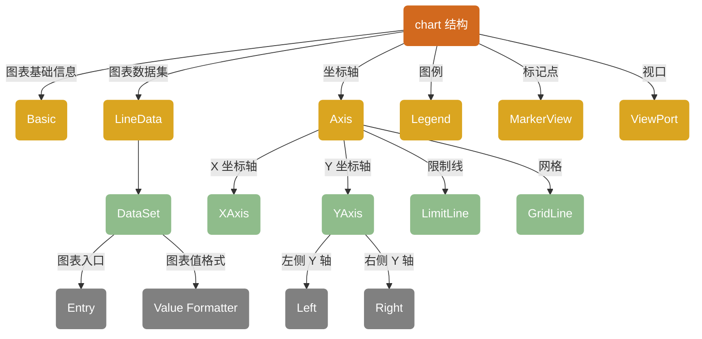
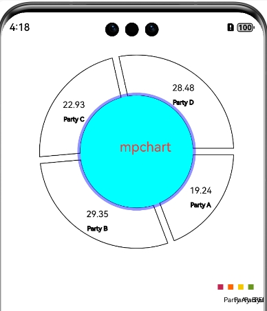
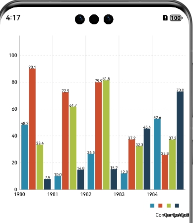
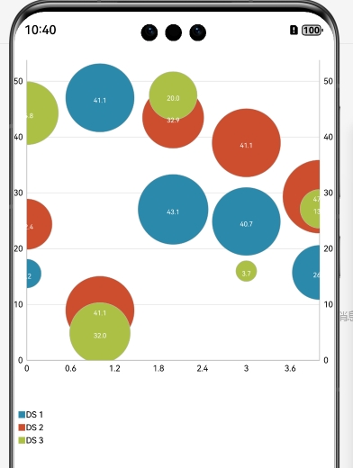
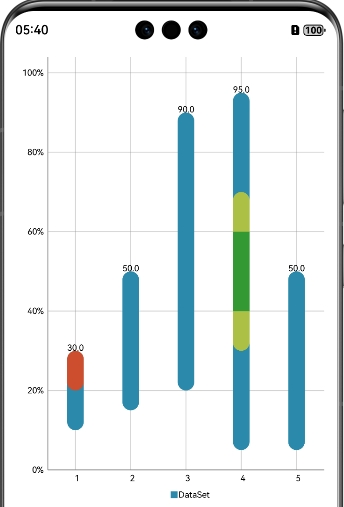
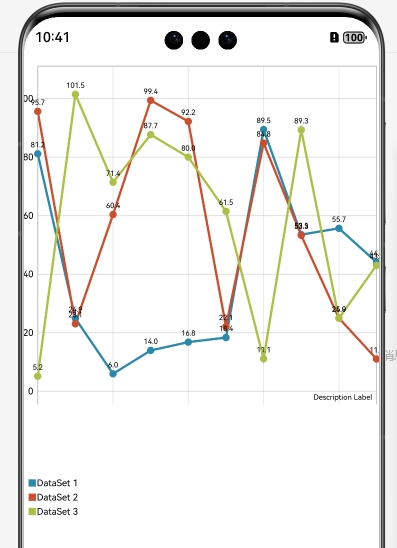
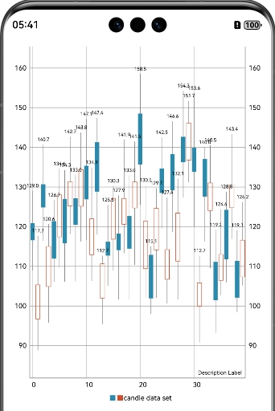
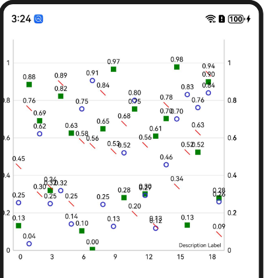
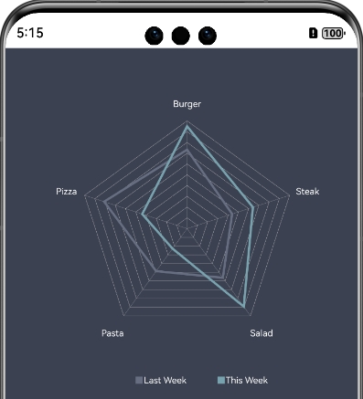
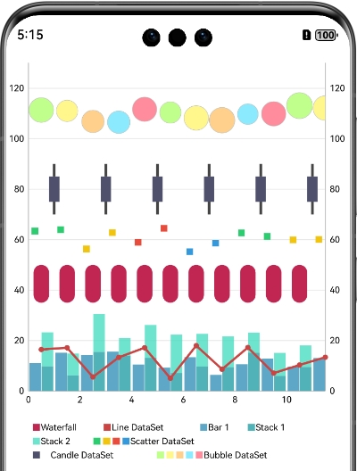

<div align="center">
<h1>chart4cj</h1>
</div>

<p align="center">


</p>

## 介绍

chart4cj 是一个包含各种类型图表的图表库，主要用于业务数据汇总，例如销售数据走势图，股价走势图等场景中使用，方便开发者快速实现图表 UI。chart4cj 提供线形图、柱状图、饼状图、蜡烛图、气泡图、雷达图、瀑布图、组合图和自定义图表的功能。

## 特性

- 支持饼状图
- 支持图例
- 支持柱状图（水平、垂直）
- 支持气泡图
- 支持瀑布图
- 支持线形图(暂不支持曲线及其填充)
- 支持蜡烛图
- 支持散点图
- 支持雷达图
- 支持组合图表

## 软件架构


### 源码目录

```shell
├─AppScope
├─doc        # API文档和使用手册存放目录                   
├─entry      # 示例代码文件夹                  
├─chart    # chart 库文件夹                   
│  └─src
│      └─main
│          ├─cangjie
│          │  └─src           # 框架代码目录   
│          │      ├─bar       # 柱状图代码目录
│          │      ├─basedata  # 基础依赖目录
│          │      ├─bubble    # 气泡图代码目录
│          │      ├─candle    # 蜡烛图代码目录
│          │      ├─charts    # 各类型图表目录
│          │      ├─components # 组件目录
│          │      ├─line      # 线形图状图代码目录
│          │      ├─pie       # 饼状图图代码目录
│          │      ├─radar     # 雷达图代码目录
│          │      ├─scatter   # 散点图代码目录
│          │      ├─utils     # 工具类目录
│          │      ├─waterfall # 瀑布图代码目录
│          └─resources
├─hvigor  # 构建工具目录
├─README.md  # chart4cj 介绍及使用说明
```
## 接口说明

主要类和函数接口说明详见 [API](doc/feature_api.md)

## 使用说明

1. 通过 module 引入
    1. 克隆下载项目
    2. 将 chart 模块拷贝到应用项目下
    3. 修改自身应用 entry 下的 oh-package.json5 文件，在 dependencies 字段添加 "chart": "file:../chart"
      ```json
      {
         "name": "entry",
         "version": "1.0.0",
         "description": "Please describe the basic information.",
         "main": "",
         "author": "",
         "license": "",
        "dependencies": {
            "markdown": "file:../chart"
        }
      }
      ```
    4. 修改自身应用 entry/src/main/cangjie 下的 cjpm.toml 文件，在 [dependencies] 字段下添加 chart = {path = "../../../../chart/src/main/cangjie", version = "1.0.0"}
       ```toml
       [dependencies]
           chart = {path = "../../../../chart/src/main/cangjie", version = "1.0.0"}
       ```
    5. 在项目中使用 import chart.* 引用 chart 项目
       ```cangjie
       import chart.*
       ```
2. 把 chart4cj 作为三方库依赖引入
    1. 目标工程把 chart4cj 依赖库作为 git submodule 引入

    ```
    > cd $工程根目录
    > mkdir third-party
    > cd third-party
    > git submodule add "https://gitcode.com/Cangjie-TPC/chart4cj.git"
    ```
    2. 修改自身应用 entry/src/main/cangjie 下的 cjpm.toml 文件，添加依赖
    ```toml
    [dependencies]
        chart = {path = "../../../../third-party/chart4cj/chart/src/main/cangjie", version = "1.0.0"}
     ```
    3. 在项目中使用 chart 组件
       ```cangjie
       import chart.*
       ```

## 功能示例

#### 饼状图示例

```cangjie
import ohos.base.*
import ohos.component.*
import ohos.state_manage.*
import ohos.state_macro_manage.*
import std.collection.{ArrayList}
import std.math.*
import std.random.*
import chart.charts.*
import chart.pie.*
import chart.utils.*
import chart.components.*

@Entry
@Component
class PieChartPageReadme {
    private var model: PieChartModel = PieChartModel.build()
    protected let parties: Array<String> = ["Party A", "Party B", "Party C", "Party D", "Party E", "Party F", "Party G",
    "Party H", "Party I", "Party J", "Party K", "Party L", "Party M", "Party N", "Party O", "Party P", "Party Q",
    "Party R", "Party S", "Party T", "Party U", "Party V", "Party W", "Party X", "Party Y", "Party Z"]

    var pieData: PieData = PieData()

    protected override func aboutToAppear() {
        let l: ?Legend = this.model.getLegend() //设置图例
        if (let Some(v) <- l) {
            v.setEnabled(true) //设置图例显示
            v.setOrientation(LegendOrientation.HORIZONTAL) // 设置图例方向为水平
            v.setVerticalAlignment(LegendVerticalAlignment.BOTTOM) // 设置图例垂直对齐方式为底部
            v.setHorizontalAlignment(LegendHorizontalAlignment.CENTER) // 设置图例水平对齐方式为居中
            v.setYOffset(-10.0)
        }

        this.model.animateX(1000, easing: "Sharp") // 启用X轴动画效果，动画持续时间为1000毫秒
        this.model.setUsePercentValues(true) // 使用百分比值
        this.model.getDescription().setEnabled(false) // 禁用描述信息
        this.model.setExtraOffsets(5.0, 10.0, 5.0, 5.0) // 设置额外偏移量

        this.model.setCenterText("chart") // 设置中心文本
        this.model.setDrawCenterText(true)
        this.model.setCenterTextSize(20.0) // 设置中心文本大小
        this.model.setCenterTextColor(0xFF3333)

        this.model.setDrawHoleEnabled(true) // 启用绘制中心孔
        this.model.setHoleColor(0xFF00FFFF) // 设置中心孔颜色

        this.model.setTransparentCircleColor(0xff0000FF) // 设置透明圆环颜色
        this.model.setTransparentCircleAlpha(110.0) // 设置透明圆环透明度

        this.model.setHoleRadius(58.0) // 设置中心孔半径
        this.model.setTransparentCircleRadius(61.0) // 设置透明圆环半径

        this.model.setDrawCenterText(true) // 绘制中心文本
        this.model.setEntryLabelColor(0xFF000000)
        this.model.setEntryLabelTextSize(30.0)
        this.model.setRotationAngle(0.0) // 设置旋转角度

        // 通过触摸启用图表的旋转
        this.model.setRotationEnabled(true)

        this.setData(4, 10) // 设置图表数据
    }

    //初始化饼状图数据
    private func setData(count: Int64, range: Int64): Unit {
        var entries: ArrayList<PiEntry> = ArrayList<PiEntry>()
        for (i in 0..count) {
            entries.append(
                PiEntry(
                    (Random().nextFloat64() * Float64(range)) + Float64(range) / 5.0,
                    this.parties[i % this.parties.size]
                )
            )
        }

        // 创建饼状图数据集对象，设置数据项和数据集名称
        var dataSet: PieDataSet = PieDataSet(entries, "Election Results")
        // 设置是否绘制数据项图标
        dataSet.setDrawIcons(false)
        // 设置数据项之间的间隙
        dataSet.setSliceSpace(10.0)
        // 设置数据项图标的偏移量
        dataSet.setIconsOffset(MPPointF(0.0, 40.0))
        // 设置选中时数据项的偏移距离
        dataSet.setSelectionShift(5.0)

        // 添加颜色
        var colors: ArrayList<UInt32> = ArrayList<UInt32>()
        for (i in 0..ColorTemplate.COLORFUL_COLORS.size) {
            colors.append(UInt32(ColorTemplate.COLORFUL_COLORS[i]))
        }

        for (i in 0..ColorTemplate.VORDIPLOM_COLORS.size) {
            colors.append(UInt32(ColorTemplate.VORDIPLOM_COLORS[i]))
        }

        for (i in 0..ColorTemplate.JOYFUL_COLORS.size) {
            colors.append(UInt32(ColorTemplate.JOYFUL_COLORS[i]))
        }

        for (i in 0..ColorTemplate.LIBERTY_COLORS.size) {
            colors.append(UInt32(ColorTemplate.LIBERTY_COLORS[i]))
        }
        for (i in 0..ColorTemplate.PASTEL_COLORS.size) {
            colors.append(UInt32(ColorTemplate.PASTEL_COLORS[i]))
        }
        colors.append(UInt32(ColorTemplate.getHoloBlue()))
        dataSet.setColorsByList(colors)

        // 生成图表数据
        let data: PieData = PieData(dataSet)
        // 将数据与图表配置类绑定
        this.model.setData(data)
    }

    func build() {
        Column {
            // 为组件设置配置构建类，如果需要在页面初始化就显示图表，则需要在 aboutToAppear 方法中完成图表数据构建
            // 如果在之后通过事件触发，
            // 可通过dataSet.notifyDataSetChanged() 来触发数据更新，
            // 可通过this.model.notifyDataSetChanged() 来触发坐标轴数据更新，
            // 可通过this.model.invalidate() 来触发绘制更新。
            PieChart(model: this.model)
        }.width(100.percent).height(70.percent).backgroundColor(Color.WHITE)
    }
}
```
<p align="left">

</p>

#### 柱状图示例

```cangjie
import ohos.base.*
import ohos.component.*
import ohos.state_manage.*
import ohos.state_macro_manage.*
import std.collection.{ArrayList}
import std.math.*
import std.random.*
import chart.pie.*
import chart.utils.*
import chart.bar.*
import chart.charts.*
import chart.components.*

@Entry
@Component
class BarChartPageReadme {
    private var model: BarChartModel = BarChartModel.build()
    private var leftAxis: ?YAxis = Option<YAxis>.None
    private var rightAxis: ?YAxis = Option<YAxis>.None
    private var xAxis: ?XAxis = Option<XAxis>.None
    private var barData: BarData = BarData()

    protected override func aboutToAppear() {
        let description: Description = this.model.getDescription() // 获取图表描述部件
        description.setEnabled(false) //设置图表描述部件不可用

        let l: ?Legend = this.model.getLegend() // 获取图表图例部件，设置图表图例部件不可用
        if (let Some(v) <- l) {
            v.setEnabled(true) //设置图表图例部件可用
            v.setOrientation(LegendOrientation.HORIZONTAL) // 设置图例方向为垂直
            v.setVerticalAlignment(LegendVerticalAlignment.BOTTOM) // 设置图例垂直对齐方式为底部
            v.setHorizontalAlignment(LegendHorizontalAlignment.CENTER) // 设置图例水平对齐方式为左侧
            v.setDrawInside(true) // 设置图例绘制在图表内部
            v.setYOffset(-10.0) // 设置图例Y轴偏移
        }

        this.model.setMaxVisibleValueCount(60) // 设置图表最大可见数值数量
        this.model.setDrawGridBackground(false) // 设置图表网格背景色
        this.model.setGridBackgroundColor(0x500000ff) // 设置图表网格背景颜色
        this.model.setDrawBarShadow(false) // 设置不绘制图的柱体阴影背景
        this.model.setDrawValueAboveBar(true) // 设置瀑布图的数值在柱体上方
        this.model.setExtraOffsets(15.0, 0.0, 30.0, 0.0) // 设置图表整体偏移

        this.leftAxis = this.model.getAxisLeft()
        if (let Some(leftaxis) <- this.leftAxis) {
            leftaxis.setAxisMinimum(0.0) // 设置左侧Y轴的最小值为 0
            leftaxis.setDrawLimitLinesBehindData(true) // 设置是否在数据后绘制限制线
            leftaxis.setSpaceTop(30.0) //设置距离顶部距离
            leftaxis.enableGridDashedLine(10, 10) //设置网格样式
        }

        this.rightAxis = this.model.getAxisRight()
        if (let Some(rightaxis) <- this.rightAxis) {
            rightaxis.setEnabled(false) // 设置右侧 Y 轴是否显示
            rightaxis.setDrawGridLines(false) //不绘制 Y 轴网格线
            rightaxis.setLabelCount(6, false) // 设置右侧 Y 轴标签数量
            rightaxis.setSpaceTop(11.0) //设置距离顶部距离
        }

        this.xAxis = this.model.getXAxis()
        if (let Some(xaxis) <- this.xAxis) {
            xaxis.setLabelCount(5, false) // 设置 X 轴标签数量
            xaxis.setPosition(XAxisPosition.BOTTOM) // 设置X轴位置在底部
        }

        if (this.xAxis.isSome() && this.leftAxis.isSome()) {
            this.setData(5, 110)
        }
    }

    private func setData(count: Int64, range: Int64): Unit {
        let groupSpace: Float64 = 0.08
        let barSpace: Float64 = 0.03
        let barWidth: Float64 = 0.2

        let startYear: Int64 = 1980
        let endYear: Int64 = startYear + count

        let values1: ArrayList<BarEntry> = ArrayList<BarEntry>()
        let values2: ArrayList<BarEntry> = ArrayList<BarEntry>()
        let values3: ArrayList<BarEntry> = ArrayList<BarEntry>()
        let values4: ArrayList<BarEntry> = ArrayList<BarEntry>()

        let randomMultiplier: Int64 = range

        for (i in startYear..endYear) {
            values1.append(BarEntry(Float64(i), (Random().nextFloat64() * Float64(randomMultiplier))))
            values2.append(BarEntry(Float64(i), (Random().nextFloat64() * Float64(randomMultiplier))))
            values3.append(BarEntry(Float64(i), (Random().nextFloat64() * Float64(randomMultiplier))))
            values4.append(BarEntry(Float64(i), (Random().nextFloat64() * Float64(randomMultiplier))))
        }

        var set1: ?BarDataSet
        var set2: ?BarDataSet
        var set3: ?BarDataSet
        var set4: ?BarDataSet

        if (this.model.getBarData().isSome() && this.model.getBarData()().getDataSetCount() > 0) {
            set1 = this.model.getBarData()().getDataSetByIndex(0) as BarDataSet
            set2 = this.model.getBarData()().getDataSetByIndex(1) as BarDataSet
            set3 = this.model.getBarData()().getDataSetByIndex(2) as BarDataSet
            set4 = this.model.getBarData()().getDataSetByIndex(3) as BarDataSet
            set1().setEntries(values1)
            set2().setEntries(values2)
            set3().setEntries(values3)
            set4().setEntries(values4)
            this.model.getBarData()().notifyDataChanged()
            this.model.notifyDataSetChanged()
        } else {
            set1 = BarDataSet(values1, "Company A")
            set1().setColorsByArr([0x2b89ab]) // 设置柱状图颜色
            set2 = BarDataSet(values2, "Company B")
            set2().setColorsByArr([0xcd4e2e])
            set3 = BarDataSet(values3, "Company C")
            set3().setColorsByArr([0xacc045])
            set4 = BarDataSet(values4, "Company D")
            set4().setColorsByArr([0x224058])

            let dataSets: ArrayList<IBarDataSet> = ArrayList<IBarDataSet>()
            dataSets.append(set1())
            dataSets.append(set2())
            dataSets.append(set3())
            dataSets.append(set4())

            let data: BarData = BarData(dataSets)
            this.model.setData(data)
        }

        this.model.getBarData()().setBarWidth(barWidth) // 设置柱状图宽度
        this.xAxis().setAxisMinimum(Float64(startYear)) // 设置轴最小值
        this.xAxis().setAxisMaximum(
            Float64(startYear) + this.model.getBarData()().getGroupWidth(groupSpace, barSpace) * Float64(count)) // 设置轴最大值
        this.model.groupBars(Float64(startYear), groupSpace, barSpace) // 设置柱状图分组
        this.model.invalidate() //手动触发图表重新绘制
    }

    func build() {
        Column {
            // 为组件设置配置构建类，如果需要在页面初始化就显示图表，则需要在 aboutToAppear 方法中完成图表数据构建
            // 如果在之后通过事件触发，
            // 可通过 barData.notifyDataSetChanged() 来触发数据更新，
            // 可通过 this.model.notifyDataSetChanged() 来触发坐标轴数据更新，
            // 可通过 this.model.invalidate() 来触发绘制更新。
            BarChart(model: this.model)
        }.width(100.percent).height(70.percent).backgroundColor(Color.WHITE)
    }
}
extend<T> Option<T> {
    operator func ()(): T {
        this.getOrThrow()
    }
}
```
<p align="left">

</p>

#### 气泡图示例

```cangjie
import ohos.base.*
import ohos.component.*
import ohos.state_manage.*
import ohos.state_macro_manage.*
import std.collection.{ArrayList}
import std.math.*
import std.random.*
import chart.pie.*
import chart.utils.*
import chart.bubble.*
import chart.charts.*
import chart.components.*

@Entry
@Component
class BubbleChartPageReadme {
    private var model: BubbleChartModel = BubbleChartModel.build()
    var isDrawValuesEnable: Bool = true

    protected override func aboutToAppear() {
        let l: ?Legend = this.model.getLegend() //设置图例
        if (let Some(v) <- l) {
            v.setEnabled(true) //设置图例显示
            v.setOrientation(LegendOrientation.HORIZONTAL) // 设置图例方向为水平
            v.setVerticalAlignment(LegendVerticalAlignment.BOTTOM) // 设置图例垂直对齐方式为底部
            v.setHorizontalAlignment(LegendHorizontalAlignment.CENTER) // 设置图例水平对齐方式为居中
            v.setYOffset(-10.0) // 设置 Y 轴方向的偏移量
        }

        let description: Description = this.model.getDescription() // 获取描述对象
        description.setEnabled(false) // 禁用图表描述

        this.model.setMaxVisibleValueCount(60) // 设置图表最大可见数值数量
        this.model.setDrawGridBackground(false) // 设置不绘制网格背景

        let xAxis: ?XAxis = this.model.getXAxis() // 获取 X 轴对象
        if (let Some(x) <- xAxis) {
            x.setPosition(XAxisPosition.BOTTOM) // 设置X轴位置在底部
            x.setDrawGridLines(false) // 不绘制X轴网格线
            x.setLabelCount(7, false) // 设置X轴标签数量为7
        }

        let leftAxis: ?YAxis = this.model.getAxisLeft() // 获取左侧Y轴对象
        if (let Some(ly) <- leftAxis) {
            ly.setLabelCount(8, false) // 设置左侧 Y 轴标签数量为 8，不强制使用整数标签
            ly.setPosition(YAxisLabelPosition.OUTSIDE_CHART) // 设置左侧 Y 轴标签位置在图表外部
            ly.setSpaceTop(15.0) // 设置左侧 Y 轴顶部空白区域大小
            ly.setAxisMinimum(0.0) // 设置左侧 Y 轴的最小值为 0
        }

        let rightAxis: ?YAxis = this.model.getAxisRight() // 获取右侧Y轴对象
        if (let Some(ry) <- rightAxis) {
            ry.setLabelCount(8, false) // 设置右侧Y轴标签数量为 8
            ry.setDrawGridLines(false) //，不绘制右侧Y轴网格线
            ry.setSpaceTop(15.0) // 设置右侧Y轴顶部空白区域大小
            ry.setAxisMinimum(0.0) // 设置右侧Y轴的最小值为 0
        }

        let start: Int64 = 1
        let values: ArrayList<BubblesEntry> = ArrayList<BubblesEntry>()
        for (i in start..20) {
            let val = (Random().nextFloat64() * 41.0)

            if (Random().nextFloat64() * 100.0 < 25.0) {
                values.append(BubblesEntry(Float64(i), val))
            } else {
                values.append(BubblesEntry(Float64(i), val))
            }
        }
        // 创建散点图数据集
        let dataSet: BubbleDataSet = BubbleDataSet(values, "DataSet")
        dataSet.setDrawIcons(false)

        // 创建散点图数据集合
        let dataSetList: ArrayList<BubbleDataSet> = ArrayList<BubbleDataSet>()
        dataSetList.append(dataSet)

        // 设置图表数据
        this.setData(5, 50.0)
        this.model.notifyDataSetChanged()
        this.model.setVisibleXRangeMaximum(7.0)
        this.model.setExtraOffsets(15.0, 0.0, 30.0, 0.0) // 设置图表整体偏移
    }

    private func setData(count: Int64, range: Float64): Unit {
        // 生成随机数据集合
        let values1 = ArrayList<BubblesEntry>()
        let values2 = ArrayList<BubblesEntry>()
        let values3 = ArrayList<BubblesEntry>()

        for (i in 0..count) {
            values1.append(BubblesEntry(Float64(i), Random().nextFloat64() * range, size: Random().nextFloat64() * range
            ))
            values2.append(BubblesEntry(Float64(i), Random().nextFloat64() * range, size: Random().nextFloat64() * range
            ))
            values3.append(BubblesEntry(Float64(i), Random().nextFloat64() * range, size: Random().nextFloat64() * range
            ))
        }
        // 创建散点图数据集1
        let set1: BubbleDataSet = BubbleDataSet(values1, "DS 1")
        set1.setDrawIcons(false)
        set1.setColorByColor(0x2b89ab)
        set1.setIconsOffset(MPPointF(0.0, 0.0))
        set1.setDrawValues(this.isDrawValuesEnable)

        // 创建散点图数据集2
        let set2: BubbleDataSet = BubbleDataSet(values2, "DS 2")
        set2.setDrawIcons(false)
        set2.setIconsOffset(MPPointF(0.0, 0.0))
        set2.setColorByColor(0xcd4e2e)
        set2.setDrawValues(this.isDrawValuesEnable)

        // 创建散点图数据集3
        let set3: BubbleDataSet = BubbleDataSet(values3, "DS 3")
        set3.setDrawIcons(false)
        set3.setIconsOffset(MPPointF(0.0, 0.0))
        set3.setColorByColor(0xacc045)
        set3.setDrawValues(this.isDrawValuesEnable)

        // 创建散点图数据集合
        let dataSets = ArrayList<IBubbleDataSet>()
        dataSets.append(set1)
        dataSets.append(set2)
        dataSets.append(set3)

        // 创建散点图数据
        let dataResult: BubbleData = BubbleData(dataSets)
        dataResult.setDrawValues(this.isDrawValuesEnable) // 设置显示数据项文本
        dataResult.setValueTextSize(8.0) // 设置数据项文本大小
        dataResult.setValueTextColor(0xffffff) // 设置数据项文本颜色
        dataResult.notifyDataChanged()

        this.model.setData(dataResult)
    }

    func build() {
        Column() {
            Column() {
                // 为组件设置配置构建类，如果需要在页面初始化就显示图表，则需要在 aboutToAppear 方法中完成图表数据构建
                // 如果在之后通过事件触发，
                // 可通过dataResult.notifyDataSetChanged() 来触发数据更新，
                // 可通过this.model.notifyDataSetChanged() 来触发坐标轴数据更新，
                // 可通过this.model.invalidate() 来触发绘制更新。
                BubbleChart(model: this.model)
            }
        }
    }
}
```
<p align="left">

</p>

#### 瀑布图示例

```cangjie
import ohos.base.*
import ohos.component.*
import ohos.state_manage.*
import ohos.state_macro_manage.*
import std.collection.{ArrayList}
import std.math.*
import std.random.*
import std.format.*
import chart.pie.*
import chart.utils.*
import chart.components.*
import chart.charts.*
import chart.waterfall.*

@Entry
@Component
class WaterfallChartPageReadme {
    private var model: WaterfallChartModel = WaterfallChartModel.build()
    private var dataSet: WaterfallDataSet = WaterfallDataSet(ArrayList<WaterfallEntry>(), "")
    private var leftAxis: ?YAxis = Option<YAxis>.None
    private var rightAxis: ?YAxis = Option<YAxis>.None
    private var xAxis: ?XAxis = Option<XAxis>.None
    private var data: WaterfallData = WaterfallData()
    private var normalMarker: MarkerView = MarkerView()

    protected override func aboutToAppear() {
        // 获取图表描述部件，设置图表描述部件不可用，即图表不进行绘制描述部件
        let description: ?Description = this.model.getDescription()
        if (let Some(des) <- description) {
            des.setEnabled(false)
        }

        // 获取图表图例部件，设置图表图例部件不可用
        let l: ?Legend = this.model.getLegend()
        if (let Some(v) <- l) {
            v.setEnabled(true)
            v.setOrientation(LegendOrientation.HORIZONTAL)
            v.setVerticalAlignment(LegendVerticalAlignment.BOTTOM)
            v.setHorizontalAlignment(LegendHorizontalAlignment.CENTER)
            v.setDrawInside(true)
            v.setYOffset(-10.0)
        }

        // 设置图表数据最大的绘制数，如果超过该数值，则不进行绘制图表的数值标签
        this.model.setMaxVisibleValueCount(40)
        // 是否绘制图表的背景色，绘制范围为图表瀑布图的绘制范围，不包含轴线之外的部分
        this.model.setDrawGridBackground(false)
        // 设置图表的背景色
        this.model.setGridBackgroundColor(0x500000ff)
        // 设置不绘制瀑布图的柱体阴影背景
        this.model.setDrawBarShadow(false)
        // 设置瀑布图的数值在柱体上方
        this.model.setDrawValueAboveBar(true)
        this.model.setExtraOffsets(20.0, 0.0, 30.0, 0.0) // 设置图表整体偏移

        this.leftAxis = this.model.getAxisLeft()
        if (let Some(laxis) <- this.leftAxis) {
            laxis.setAxisMinimum(0.0)
            laxis.setDrawLimitLinesBehindData(false)
            laxis.setValueFormatter(CustomFormatter())
        }

        this.rightAxis = this.model.getAxisRight()
        if (let Some(r) <- this.rightAxis) {
            r.setEnabled(false)
            r.setAxisMinimum(0.0)
        }

        this.xAxis = this.model.getXAxis()
        if (let Some(x) <- this.xAxis) {
            x.setPosition(XAxisPosition.BOTTOM)
        }

        this.normalMarker = MarkerView()
        this.model.setMarker(this.normalMarker)

        this.data = this.getNormalData()
        this.model.setData(this.data)
        this.model.setVisibleXRangeMaximum(5.0)
    }

    private func getNormalData(): WaterfallData {
        let values: ArrayList<WaterfallEntry> = ArrayList<WaterfallEntry>()
        // 设置标记点位置及颜色
        let h1 = WaterfallHighlight(20.0, 30.0, color: 0xcd4e2e)
        let h2 = WaterfallHighlight(30.0, 40.0, color: 0xacc045)
        let h3 = WaterfallHighlight(40.0, 60.0, color: 0x339933)
        let h4 = WaterfallHighlight(60.0, 70.0, color: 0xacc045)

        values.append(WaterfallEntry(1.0, 10.0, 30.0, highlights: [h1]))
        values.append(WaterfallEntry(2.0, 15.0, 50.0))
        values.append(WaterfallEntry(3.0, 20.0, 90.0))
        values.append(WaterfallEntry(4.0, 5.0, 95.0, highlights: [h2, h3, h4]))
        values.append(WaterfallEntry(5.0, 5.0, 50.0))
        values.append(WaterfallEntry(6.0, 45.0, 80.0, highlights: [h2, h3]))
        values.append(WaterfallEntry(7.0, 60.0, 70.0))

        this.dataSet = WaterfallDataSet(values, "DataSet")
        this.dataSet.setDrawIcons(false)
        // 为柱体添加颜色信息
        this.dataSet.setColorByColor(0x2b89ab)
        this.dataSet.setValueTextSize(10.0)

        let dataSetList: ArrayList<IWaterfallDataSet> = ArrayList<IWaterfallDataSet>()
        dataSetList.append(this.dataSet)

        let data: WaterfallData = WaterfallData(dataSetList)
        data.setBarWidth(0.3)
        return data
    }

    func build() {
        Column() {
            Column() {
                WaterfallChart(model: this.model)
            }
        }
    }
}

class CustomFormatter <: IAxisValueFormatter {
    public func getFormattedValue(value: Float64, axis: AxisBase): String {
        let str = value.format(".0").split(".")
        return "${str[0]}%"
    }
}
```
<p align="left">

</p>

#### 线形图示例

```cangjie
import ohos.base.*
import ohos.component.*
import ohos.state_manage.*
import ohos.state_macro_manage.*
import std.collection.*
import std.math.*
import std.random.*
import chart.pie.*
import chart.utils.{Mode, AxisDependency, ColorTemplate, ChartColor}
import chart.charts.*
import chart.line.*
import chart.components.*

@Entry
@Component
class LineChartNotAxisConfigPageReadme {
    private var model: LineChartModel = LineChartModel.build()
    var minOffset: Float64 = 15.0
    var leftAxis: ?YAxis = None
    var rightAxis: ?YAxis = None
    var lineData: LineData = LineData()

    protected override func aboutToAppear() {
        let legend: ?Legend = this.model.getLegend() //设置图例
        if (let Some(v) <- legend) {
            v.setEnabled(true) //设置图例显示
            v.setOrientation(LegendOrientation.HORIZONTAL) // 设置图例方向为水平
            v.setVerticalAlignment(LegendVerticalAlignment.BOTTOM) // 设置图例垂直对齐方式为底部
            v.setHorizontalAlignment(LegendHorizontalAlignment.CENTER) // 设置图例水平对齐方式为居中
            v.setDrawInside(true) // 设置图例绘制在图表内侧
            v.setYOffset(-10.0) // 设置 Y 轴方向的偏移量
        }

        this.model.setExtraOffsets(15.0, 0.0, 30.0, 0.0) // 设置图表整体偏移
        this.lineData = this.setData(10, 100.0)
        this.model.setData(this.lineData)
    }

    private func setData(count: Int64, range: Float64): LineData {
        let values1 = ArrayList<EntryOhos>()
        let values2 = ArrayList<EntryOhos>()
        let values3 = ArrayList<EntryOhos>()

        for (i in 0..count) {
            let val: Float64 = Random().nextFloat64() * range + 3.0
            values1.append(EntryOhos(Float64(i), val))
        }

        for (i in 0..count) {
            let val: Float64 = Random().nextFloat64() * range + 3.0
            values2.append(EntryOhos(Float64(i), val))
        }

        for (i in 0..count) {
            let val: Float64 = Random().nextFloat64() * range + 3.0
            values3.append(EntryOhos(Float64(i), val))
        }

        let dataSet = ArrayList<ILineDataSet>()

        let gradientFillColor = ArrayList<ChartColorStop>()
        gradientFillColor.append((0xffffff, 0.3))
        gradientFillColor.append((0x00ffff, 1.0))

        let set1 = LineDataSet(values1, "DataSet 1")
        set1.setDrawFilled(false) //设置不渐变色填充
        set1.setDrawValues(true) //设置数据标签显示
        set1.setDrawCircles(true) //折线点画圆圈
        set1.setCircleColor(0x2b89ab) // 设置数据点的颜色
        set1.setCircleRadius(4.0) // 设置半径大小
        set1.setMode(Mode.LINEAR) //直线模式
        set1.setColorByColor(0x2b89ab) //设置折线颜色
        set1.setLineWidth(2.5) //设置线宽
        dataSet.append(set1)

        let set2 = LineDataSet(values2, "DataSet 2")
        set2.setDrawFilled(false) //设置不渐变色填充
        set2.setDrawValues(true) //设置数据标签显示
        set2.setDrawCircles(true) //折线点画圆圈
        set2.setCircleColor(0xcd4e2e) // 设置数据点的颜色
        set2.setCircleRadius(4.0) // 设置半径大小
        set2.setMode(Mode.STEPPED) //90度线模式
        set2.setColorByColor(0xcd4e2e) //设置折线颜色
        set2.setLineWidth(2.5) //设置线宽
        dataSet.append(set2)

        let set3 = LineDataSet(values3, "DataSet 3")
        set3.setDrawFilled(false) //设置不渐变色填充
        set3.setDrawValues(true) //设置数据标签显示
        set3.setDrawCircles(true) //折线点画圆圈
        set3.setCircleColor(0xacc045) // 设置数据点的颜色
        set3.setCircleRadius(4.0) // 设置半径大小
        set3.setMode(Mode.LINEAR) //直线模式
        set3.setColorByColor(0xacc045) //设置折线颜色
        set3.setLineWidth(2.5) //设置线宽
        dataSet.append(set3)

        let lineData: LineData = LineData(dataSet)

        return lineData
    }

    func build() {
        Column {
            // 为组件设置配置构建类，如果需要在页面初始化就显示图表，则需要在 aboutToAppear 方法中完成图表数据构建
            // 如果在之后通过事件触发，
            // 可通过lineData.notifyDataSetChanged() 来触发数据更新，
            // 可通过this.model.notifyDataSetChanged() 来触发坐标轴数据更新，
            // 可通过this.model.invalidate() 来触发绘制更新。
            LineChart(model: this.model)
        }.width(100.percent).height(70.percent).backgroundColor(Color.WHITE)
    }
}
```
<p align="left">

</p>

#### 蜡烛图示例

```cangjie

import ohos.base.*
import ohos.component.*
import ohos.state_manage.*
import ohos.state_macro_manage.*
import std.collection.{ArrayList}
import std.math.*
import std.random.*
import chart.pie.*
import chart.utils.*
import chart.candle.*
import chart.charts.*
import chart.components.*

@Entry
@Component
class CandleChartPageReadme {
    private var model: CandleStickChartModel = CandleStickChartModel.build()

    protected override func aboutToAppear() {
        let l: ?Legend = this.model.getLegend() //设置图例
        if (let Some(v) <- l) {
            v.setEnabled(true) //设置图例显示
            v.setOrientation(LegendOrientation.HORIZONTAL) // 设置图例方向为水平
            v.setVerticalAlignment(LegendVerticalAlignment.BOTTOM) // 设置图例垂直对齐方式为底部
            v.setHorizontalAlignment(LegendHorizontalAlignment.CENTER) // 设置图例水平对齐方式为居中
            v.setYOffset(-10.0) // 设置 Y 轴方向的偏移量
        }

        let description: Description = this.model.getDescription() // 获取描述对象
        description.setEnabled(true) // 禁用图表描述

        this.model.setMaxVisibleValueCount(60) // 设置图表最大可见数值数量
        this.model.setDrawGridBackground(true) // 设置绘制网格背景
        this.model.setGridBackgroundColor(0xffffff) // 设置绘制网格背景颜色
        this.model.setExtraOffsets(15.0, 0.0, 30.0, 0.0) // 设置图表整体偏移

        let xAxis: ?XAxis = this.model.getXAxis() // 获取 X 轴对象
        if (let Some(x) <- xAxis) {
            x.setPosition(XAxisPosition.BOTTOM) // 设置X轴位置在底部
            x.setDrawGridLines(true) // 绘制 X 轴网格线
        }

        let leftAxis: ?YAxis = this.model.getAxisLeft() // 获取左侧Y轴对象
        if (let Some(ly) <- leftAxis) {
            ly.setLabelCount(7, false) // 设置左侧 Y 轴标签数量为 7，不强制使用整数标签
            ly.setDrawGridLines(true) // 绘制左侧 Y 轴网格线
            ly.setDrawAxisLine(true) // 绘制左侧 Y 轴线
        }

        let rightAxis: ?YAxis = this.model.getAxisRight() // 获取右侧Y轴对象
        if (let Some(ry) <- rightAxis) {
            ry.setLabelCount(7, false) // 设置右侧 Y 轴标签数量为 7，不强制使用整数标签
            ry.setDrawGridLines(true) // 绘制右侧 Y 轴网格线
            ry.setDrawAxisLine(true) // 绘制右侧 Y 轴线
        }

        this.setData(40, 100.0)
        this.model.notifyDataSetChanged()
    }

    private func setData(count: Int64, range: Float64): Unit {
        // 生成随机数据集合
        let values = ArrayList<CandleEntry>()

        for (i in 0..count) {
            let val: Float64 = (Random().nextFloat64() * 40.0) + (range + 3.0)

            let high: Float64 = (Random().nextFloat64() * 9.0) + 8.0
            let low: Float64 = (Random().nextFloat64() * 9.0) + 8.0

            let open: Float64 = (Random().nextFloat64() * 6.0) + 1.0
            let close: Float64 = (Random().nextFloat64() * 6.0) + 1.0

            let even: Bool = i % 2 == 0

            values.append(
                CandleEntry(
                    Float64(i),
                    shadowH: val + high,
                    shadowL: val - low,
                    open: if (even) {
                        val + open
                    } else {
                        val - open
                    },
                    close: if (even) {
                        val - close
                    } else {
                        val + close
                    },
                )
            )
        }
        // 创建蜡烛图数据集，并设置数据集的名称为 "candle data set"
        let dataSet: CandleDataSet = CandleDataSet(values, "candle data set")
        dataSet.setDrawIcons(false) // 设置是否绘制图标为 false
        dataSet.setAxisDependency(AxisDependency.LEFT) // 设置数据集的轴依赖为左侧Y轴
        dataSet.setShadowColor(0x808080) // 设置蜡烛图阴影颜色
        dataSet.setShadowWidth(0.7) // 设置蜡烛图阴影宽度为 0.7
        dataSet.setDecreasingPaintStyle(Style.FILL) // 设置蜡烛图下跌蜡烛的绘制样式为填充
        dataSet.setDecreasingColor(0x2b89ab) // 设置蜡烛图下跌蜡烛的颜色
        dataSet.setIncreasingColor(0xcd4e2e) // 设置蜡烛图上涨蜡烛的颜色
        dataSet.setIncreasingPaintStyle(Style.STROKE) // 设置蜡烛图上涨蜡烛的绘制样式为描边
        dataSet.setNeutralColor(0x0000ff) // 设置蜡烛图中性蜡烛的颜色

        // 创建蜡烛图数据
        let data: CandleData = CandleData([dataSet])
        data.setValueTextSize(7.0)

        this.model.setData(data)
        this.model.invalidate()
    }

    func build() {
        Column() {
            Column() {
                CandleStickChart(model: this.model)
            }
        }
    }
}
```

<p align="left">

</p>

#### 散点图示例

```cangjie
import ohos.base.*
import ohos.component.*
import ohos.state_manage.*
import ohos.state_macro_manage.*
import std.collection.{ArrayList}
import std.math.*
import std.random.*
import chart.pie.*
import chart.utils.*
import chart.charts.*
import chart.components.*
import chart.scatter.*

@Entry
@Component
class ScatterChartPageReadme {
    private var model: ScatterChartModel = ScatterChartModel.build()

    protected override func aboutToAppear() {
        let l: ?Legend = this.model.getLegend()
        if (let Some(legend) <- l) {
            legend.setEnabled(true) // 启用图例
            legend.setOrientation(LegendOrientation.HORIZONTAL)
            legend.setVerticalAlignment(LegendVerticalAlignment.BOTTOM)
            legend.setHorizontalAlignment(LegendHorizontalAlignment.CENTER)
            legend.setYOffset(-10.0)
        }

        let description: Description = this.model.getDescription() // 获取描述对象
        description.setEnabled(true)

        // 设置图表最大可见数值数量、是否支持缩放、是否绘制网格背景
        this.model.setMaxVisibleValueCount(160)
        this.model.setDrawGridBackground(false)
        this.model.setExtraOffsets(15.0, 0.0, 30.0, 0.0) // 设置图表整体偏移
        this.model.animateXY(2000, 2000)

        let xAxis: ?XAxis = this.model.getXAxis() // 获取X轴对象
        if (let Some(xAxis) <- xAxis) {
            xAxis.setPosition(XAxisPosition.BOTTOM) // 设置X轴位置在底部
            xAxis.setDrawGridLines(false) // 不绘制X轴网格线
            xAxis.setLabelCount(7, false) // 设置X轴标签数量为7
        }

        let leftAxis: ?YAxis = this.model.getAxisLeft() // 获取左侧Y轴对象
        if (let Some(leftAxis) <- leftAxis) {
            leftAxis.setLabelCount(8, false) // 设置左侧Y轴标签数量为8，不强制使用整数标签
            leftAxis.setPosition(YAxisLabelPosition.OUTSIDE_CHART) // 设置左侧Y轴标签位置在图表外部
            leftAxis.setSpaceTop(15.0) // 设置左侧Y轴顶部空白区域大小
            leftAxis.setAxisMinimum(0.0) // 设置左侧Y轴的最小值为0
        }

        let rightAxis: ?YAxis = this.model.getAxisRight() // 获取右侧Y轴对象
        if (let Some(rightAxis) <- rightAxis) {
            rightAxis.setLabelCount(8, false) // 设置右侧Y轴标签数量为8
            rightAxis.setDrawGridLines(false) //不绘制右侧Y轴网格线
            rightAxis.setSpaceTop(15.0) // 设置右侧Y轴顶部空白区域大小
            rightAxis.setAxisMinimum(0.0) // 设置右侧Y轴的最小值为0
        }

        this.setData(20.0, 100.0)
        this.model.notifyDataSetChanged()
    }

    private func setData(xRange: Float64, yRange: Float64): Unit {
        // 生成随机数据集合
        let values1 = this.generateRandomData(xRange, yRange)
        let values2 = this.generateRandomData(xRange, yRange)
        let values3 = this.generateRandomData(xRange, yRange)

        // 创建散点图数据集1
        let set1 = ScatterDataSet(values1, "DS 1")
        set1.setScatterShape(ChartShape.SQUARE)
        set1.setColorByColor(0x2b89ab)

        // 创建散点图数据集2
        let set2 = ScatterDataSet(values2, "DS 2")
        set2.setScatterShape(ChartShape.CIRCLE)
        set2.setScatterShapeHoleRadius(3.0)
        set2.setColorByColor(0xcd4e2e)

        // 创建散点图数据集3
        let set3 = ScatterDataSet(values3, "DS 3")
        set3.setShapeRenderer(CustomScatterShapeRenderer())
        set3.setColorByColor(0xacc045)

        // 设置散点图数据集形状大小
        set1.setScatterShapeSize(8.0)
        set2.setScatterShapeSize(8.0)
        set3.setScatterShapeSize(8.0)

        // 创建散点图数据集合
        let dataSets: ArrayList<IScatterDataSet> = ArrayList<IScatterDataSet>()
        dataSets.append(set1) // add the data sets
        dataSets.append(set2)
        dataSets.append(set3)

        // 创建散点图数据
        let dataResult: ScatterData = ScatterData(dataSets)
        dataResult.setDrawValues(true)
        dataResult.setValueTextSize(8.0) // 设置数据项文本大小
        dataResult.setHighlightEnabled(true)
        dataResult.setValueTextSize(10.0)

        this.model.setData(dataResult) // 设置图表数据
        dataResult.notifyDataChanged()
    }

    private func generateRandomData(xRange: Float64, yRange: Float64): ArrayList<EntryOhos> {
        let values = ArrayList<EntryOhos>()

        for (i in 0..Int64(xRange)) {
            let x = Float64(i)
            let y = Random().nextFloat64() * yRange
            values.append(EntryOhos(x, y))
        }
        return values
    }

    func build() {
        Column() {
            Column() {
                // 为组件设置配置构建类，如果需要在页面初始化就显示图表，则需要在 aboutToAppear 方法中完成图表数据构建
                // 如果在之后通过事件触发，
                // 可通过dataResult.notifyDataSetChanged() 来触发数据更新，
                // 可通过this.model.notifyDataSetChanged() 来触发坐标轴数据更新，
                // 可通过this.model.invalidate() 来触发绘制更新。
                ScatterChart(model: this.model)
            }
        }
    }
}

// 自定义散点形状
public class CustomScatterShapeRenderer <: IShapeRenderer {
    public func renderShape(c: CanvasRenderingContext2D, dataSet: IScatterDataSet, viewPortHandler: ViewPortHandler,
        posX: Float64, posY: Float64, renderPaint: ChartPaint): Unit {
        let shapeHalf: Float64 = dataSet.getScatterShapeSize() / 2.0

        renderPaint.setStyle(Style.STROKE)
        renderPaint.setStrokeWidth(Utils.handleDataValues(1.0))
        Utils.resetContext2DStyle(c, renderPaint)
        c.beginPath()
        c.moveTo(posX - shapeHalf, posY - shapeHalf)
        c.lineTo(posX + shapeHalf, posY + shapeHalf)
        c.stroke()
        c.closePath()
    }
}
```

<p align="left">

</p>

#### 雷达图示例

```cangjie
import ohos.base.*
import ohos.component.*
import ohos.state_manage.*
import ohos.state_macro_manage.*
import std.collection.*
import std.math.*
import std.random.*
import chart.utils.*
import chart.charts.*
import chart.radar.*
import chart.components.*
import chart.pie.*

@Entry
@Component
class RadarChartPageReadme {
    private var model: RadarChartModel = RadarChartModel.build()

    protected override func aboutToAppear() {
        let description: Description = this.model.getDescription()
        description.setEnabled(false)

        let l: ?Legend = this.model.getLegend() //设置图例
        if (let Some(legend) <- l) {
            legend.setEnabled(true) //设置图例显示
            legend.setOrientation(LegendOrientation.HORIZONTAL) // 设置图例方向为水平
            legend.setVerticalAlignment(LegendVerticalAlignment.BOTTOM) // 设置图例垂直对齐方式为底部
            legend.setHorizontalAlignment(LegendHorizontalAlignment.CENTER) // 设置图例水平对齐方式为居中
            legend.setTextColor(Color(0xffffff)) // 设置文本颜色
            legend.setDrawInside(true) // 设置图例绘制在图表内部
            legend.setXOffset(30.0) // 设置 X 轴方向的偏移量
            legend.setYOffset(20.0) // 设置 Y 轴方向的偏移量
        }

        // 设置雷达图网格线宽度、颜色和透明度
        this.model.setWebLineWidth(0.3)
        this.model.setWebColor(0xFFCCCCCC)
        this.model.setWebLineWidthInner(0.3)
        this.model.setWebColorInner(0xFFCCCCCC)
        this.model.setExtraTopOffset(-100.0)

        let xAxis: ?XAxis = this.model.getXAxis() // 获取 X 轴对象
        if (let Some(xAxis) <- xAxis) {
            xAxis.setPosition(XAxisPosition.BOTTOM) // 设置X轴位置在底部
            xAxis.setDrawGridLines(false) // 不绘制X轴网格线
            xAxis.setLabelCount(7, false) // 设置X轴标签数量为7
            xAxis.setYOffset(0.0)
            xAxis.setXOffset(0.0)
            xAxis.setValueFormatter(valueFormatter()) // 设置X轴标签值格式
            xAxis.setTextColor(Color(0xffffff)) // 设置X轴标签颜色
        }

        let leftAxis: ?YAxis = this.model.getYAxis() // 获取左侧Y轴对象
        if (let Some(yAxis) <- leftAxis) {
            yAxis.setLabelCount(5, false) // 设置Y轴标签数量为5，不强制使用整数标签
            yAxis.setDrawLabels(false) // 不绘制Y轴标签
            yAxis.setAxisMinimum(0.0)
            yAxis.setAxisMaximum(80.0)
        }

        // 设置雷达图数据
        this.setData()
    }

    private func setData(): Unit {
        let mul = 80.0 // 随机值的放大倍数
        let min = 20.0 // 随机值的最小基准
        let cnt = 5 // 数据点数量

        // 创建雷达图数据点集合
        let entries1: ArrayList<RadarEntry> = ArrayList<RadarEntry>()
        let entries2: ArrayList<RadarEntry> = ArrayList<RadarEntry>()

        // 注意: 将数据点添加到数据点数组中的顺序决定它们在图表中心周围的位置。
        for (i in 0..cnt) {
            let val1 = (Random().nextFloat64() * mul) + min
            entries1.append(RadarEntry(val1))

            let val2 = (Random().nextFloat64() * mul) + min
            entries2.append(RadarEntry(val2))
        }

        // 创建雷达图数据集
        let set1: RadarDataSet = RadarDataSet(entries1, "Last Week")
        set1.setColorByColor(UInt32(ChartColor.rgb(103, 110, 129)))
        set1.setLineWidth(2.0)

        // 创建雷达图数据集
        let set2: RadarDataSet = RadarDataSet(entries2, "This Week")
        set2.setColorByColor(UInt32(ChartColor.rgb(121, 162, 175)))
        set2.setLineWidth(2.0)

        // 创建雷达图数据集合
        let sets: ArrayList<IRadarDataSet> = ArrayList<IRadarDataSet>()
        sets.append(set1)
        sets.append(set2)

        // 创建雷达图数据对象
        let data: RadarData = RadarData(sets)
        data.setDrawValues(false) // 不绘制数据值
        data.setValueTextColor(0xffffff) // 设置数据值文字颜色为白色
        this.model.setData(data) // 设置图表数据
    }

    func build() {
        Column() {
            Column() {
                RadarChart(model: this.model)
            }.backgroundColor(0x3C4152)
        }
    }
}

class valueFormatter <: IAxisValueFormatter {
    private var mActivities: Array<String> = ["Burger", "Steak", "Salad", "Pasta", "Pizza"]

    public func getFormattedValue(value: Float64, axis: AxisBase): String {
        return this.mActivities[Int64(floor(Float64(Int64(value) % (this.mActivities.size))))]
    }
}
```

<p align="left">

</p>

#### 组合图示例

```cangjie
import ohos.base.*
import ohos.component.*
import ohos.state_manage.*
import ohos.state_macro_manage.*
import std.collection.*
import std.math.*
import std.random.*
import chart.pie.*
import chart.utils.{Mode, AxisDependency, ColorTemplate, ChartColor}
import chart.charts.*
import chart.combine.*
import chart.line.*
import chart.waterfall.*
import chart.bar.*
import chart.scatter.*
import chart.candle.*
import chart.bubble.*
import chart.components.*

@Entry
@Component
class CombinedChartPageReadme {
    private var model: CombinedChartModel = CombinedChartModel.build() //初始化图表配置构建类
    var combinedData: ?CombinedData = None
    var count: Int64 = 12

    protected override func aboutToAppear() {
        this.model.getDescription().setEnabled(false) // 禁用图表描述

        let l = this.model.getLegend() // 获取图例对象
        if (let Some(l) <- l) {
            l.setEnabled(true) // 启用图例
            l.setWordWrapEnabled(true) // 启用图例文字自动换行
            l.setHorizontalAlignment(LegendHorizontalAlignment.LEFT) // 设置图例水平对齐方式为左侧
            l.setVerticalAlignment(LegendVerticalAlignment.BOTTOM) // 设置图例垂直对齐方式为底部
            l.setDrawInside(false) // 设置图例不绘制在图表内部
            l.setYOffset(-10.0) // 设置图例 Y 轴偏移
            l.setOrientation(LegendOrientation.HORIZONTAL) // 设置图例水平方向显示
        }

        this.model.setMaxVisibleValueCount(60) // 设置图表最大可见数值数量为 60
        this.model.setDrawGridBackground(false) // 禁用图表绘制网格背景

        let xAxis: ?XAxis = this.model.getXAxis() // 获取X轴对象
        if (let Some(xAxis) <- xAxis) {
            xAxis.setPosition(XAxisPosition.BOTTOM) // 设置X轴位置在底部
            xAxis.setDrawGridLines(false) // 不绘制 X 轴网格线
            xAxis.setLabelCount(7, false) // 设置 X 轴标签数量为 7
            xAxis.setAxisMinimum(0.0) // 设置X轴最小值为 0.0
        }

        let leftAxis: ?YAxis = this.model.getAxisLeft() // 获取左侧 Y 轴对象
        if (let Some(leftAxis) <- leftAxis) {
            leftAxis.setLabelCount(8, false) // 设置左侧 Y 轴标签数量为8，不强制使用整数标签
            leftAxis.setPosition(YAxisLabelPosition.OUTSIDE_CHART) // 设置左侧 Y 轴标签位置在图表外部
            leftAxis.setSpaceTop(15.0) // 设置顶部空白区域为 15 个单位
            leftAxis.setAxisMinimum(0.0) // 设置左侧 Y 轴的最小值为 0
        }

        let rightAxis: ?YAxis = this.model.getAxisRight() // 获取右侧Y轴对象
        if (let Some(rightAxis) <- rightAxis) {
            rightAxis.setLabelCount(8, false) // 设置右侧Y轴标签数量为 8，不强制使用整数标签
            rightAxis.setDrawGridLines(false) // 不绘制右侧 Y 轴网格线
            rightAxis.setSpaceTop(15.0) // 设置顶部空白区域为 15 个单位
            rightAxis.setAxisMinimum(0.0) // 设置右侧 Y 轴的最小值为 0
        }

        let data: CombinedData = CombinedData() // 创建组合图表数据对象
        this.generateLineData(data) // 生成线形图数据
        this.generateWaterfallData(data) // 生成瀑布图数据
        this.generateBubbleData(data) // 生成气泡图数据
        this.generateScatterData(data) // 生成散点图数据
        this.generateCandleData(data) // 生成蜡烛图数据
        this.generateBarData(data) // 生成柱状图数据
        this.model.setData(data) // 设置图表数据
        this.model.invalidate() // 重绘图表
        this.model.setExtraOffsets(15.0, 0.0, 30.0, 0.0) // 设置图表整体偏移
    }

    // 生成线形图数据
    private func generateLineData(data: CombinedData): Unit {
        let d: LineData = LineData() // 创建线形图表数据对象

        var entries: ArrayList<EntryOhos> = ArrayList()

        for (index in 0..this.count) {
            entries.append(EntryOhos(Float64(index) + 0.5, this.getRandom(15.0, 5.0)))
        }

        let set: LineDataSet = LineDataSet(entries, "Line DataSet") //创建线形图数据集合
        set.setColorByColor(0xca4443) //设置折线颜色
        set.setLineWidth(2.5) //设置折线宽度
        set.setCircleColor(0xca4443) //设置数据点的颜色
        set.setCircleRadius(3.0) // 设置半径大小
        set.setMode(Mode.LINEAR) //直线模式
        set.setDrawValues(false) //不绘制值
        set.setValueTextSize(8.0) //设置值大小
        set.setValueTextColor(0xca4443) //设置值颜色
        set.setAxisDependency(AxisDependency.LEFT) //设置数据集的轴依赖为左侧 Y 轴
        d.addDataSet(set)
        data.setLineData(d)
    }

    private func generateWaterfallData(data: CombinedData): Unit {
        var values: ArrayList<WaterfallEntry> = ArrayList<WaterfallEntry>()

        for (i in 0..this.count - 1) {
            values.append(WaterfallEntry(Float64(i) + 0.5, 35.0, 50.0))
        }

        let dataSet = WaterfallDataSet(values, "Waterfall")
        dataSet.setDrawIcons(false) //不设置显示自定义图标
        dataSet.setColorByColor(UInt32(ColorTemplate.COLORFUL_COLORS[0])) //设置图颜色
        dataSet.setValueTextSize(8.0) //设置值大小
        dataSet.setDrawValues(false) //不绘制值

        let dataSetList: ArrayList<IWaterfallDataSet> = ArrayList<IWaterfallDataSet>()
        dataSetList.append(dataSet)

        let waterfallData: WaterfallData = WaterfallData(dataSetList)
        waterfallData.setBarWidth(0.6) //设置瀑布图宽度
        data.setWaterfallData(waterfallData)
    }

    private func generateBarData(data: CombinedData): Unit {
        var entries1: ArrayList<BarEntry> = ArrayList()
        var entries2: ArrayList<BarEntry> = ArrayList()

        for (index in 0..this.count) {
            // 普通柱状图
            entries1.append(BarEntry(0.0, this.getRandom(10.0, 6.0)))

            // 堆叠
            entries2.append(BarEntry(0.0, [this.getRandom(10.0, 6.0), this.getRandom(10.0, 6.0)]))
        }

        let set1: BarDataSet = BarDataSet(entries1, "Bar 1")
        set1.setColorByAlpha(0x328fb8, 200.0) // 设置柱状图颜色和透明度
        set1.setValueTextColor(0x328fb8) //设置值颜色
        set1.setValueTextSize(8.0) //设置值大小
        set1.setAxisDependency(AxisDependency.LEFT) //设置数据集的轴依赖为左侧Y轴
        set1.setDrawValues(false) // 不绘制值

        let set2: BarDataSet = BarDataSet(entries2, "")
        set2.setStackLabels(["Stack 1", "Stack 2"])
        set2.setColorsByArrAndAlpha([0x219ea4, 0x46dcc1], 200.0) // 设置堆叠柱状图颜色和透明度
        set2.setValueTextColor(0x219ea4) //设置值颜色
        set2.setValueTextSize(8.0) //设置值大小
        set2.setAxisDependency(AxisDependency.LEFT) //设置数据集的轴依赖为左侧Y轴
        set2.setDrawValues(false) // 不绘制值

        let groupSpace = 0.06 // 组间距
        let barSpace = 0.02 // 组内图间距
        let barWidth = 0.45 // 柱状图宽度

        let set: ArrayList<IBarDataSet> = ArrayList()
        set.append(set1)
        set.append(set2)
        let d: BarData = BarData(set)
        d.setBarWidth(barWidth) //设置柱状图宽度

        // 柱状图分组
        d.groupBars(0.0, groupSpace, barSpace)
        data.setBarData(d)
    }

    private func generateScatterData(data: CombinedData): Unit {
        let d: ScatterData = ScatterData()

        var entries: ArrayList<EntryOhos> = ArrayList<EntryOhos>()

        for (index in 0..this.count) {
            entries.append(EntryOhos(Float64(index) + 0.25, this.getRandom(10.0, 55.0)))
        }

        let set: ScatterDataSet = ScatterDataSet(entries, "Scatter DataSet")
        set.setColorsByArr([0x2ecc71, 0xf1c40f, 0xe74c3c, 0x3498db]) // 设置散点图颜色
        set.setScatterShapeSize(7.5) // 设置散点图大小
        set.setDrawValues(false) // 不绘制值
        set.setValueTextSize(10.0) //设置值大小
        d.addDataSet(set)
        data.setScatterData(d)
    }

    private func generateCandleData(data: CombinedData): Unit {
        let d: CandleData = CandleData()

        var entries: ArrayList<CandleEntry> = ArrayList()

        for (index in 0..this.count : 2) {
            entries.append(CandleEntry(Float64(index + 1), shadowH: 90.0, shadowL: 70.0, open: 85.0, close: 75.0))
        }

        let set: CandleDataSet = CandleDataSet(entries, "Candle DataSet")
        set.setDecreasingColor(0x4f506c) // 设置蜡烛图下跌蜡烛的颜色
        set.setShadowColor(ColorTemplate.DKGRAY) // 设置蜡烛图阴影颜色为灰色
        set.setBarSpace(0.3) // 设置蜡烛间距
        set.setValueTextSize(10.0) //设置值大小
        set.setDrawValues(false) // 不绘制值
        d.addDataSet(set)
        data.setCandleData(d)
    }

    private func generateBubbleData(data: CombinedData): Unit {
        let bd: BubbleData = BubbleData()

        let entries: ArrayList<BubblesEntry> = ArrayList<BubblesEntry>()

        for (index in 0..this.count) {
            let y = this.getRandom(10.0, 105.0)
            let size = this.getRandom(20.0, 30.0)
            entries.append(BubblesEntry(Float64(index) + 0.5, y, size: size))
        }

        let set: BubbleDataSet = BubbleDataSet(entries, "Bubble DataSet")
        set.setColorsByArr(
            [UInt32(ChartColor.rgb(192, 255, 140)), UInt32(ChartColor.rgb(255, 247, 140)),
        UInt32(ChartColor.rgb(255, 208, 140)), UInt32(ChartColor.rgb(140, 234, 255)),
        UInt32(ChartColor.rgb(255, 140, 157))]) //设置气泡图颜色
        set.setValueTextSize(8.0) //设置值大小
        set.setValueTextColor(0xffffff) // 设置值颜色
        set.setDrawValues(false) // 不绘制值
        bd.addDataSet(set)
        data.setBubbleData(bd)
    }

    func getRandom(range: Float64, start: Float64): Float64 {
        return (Random().nextFloat64() * range) + start
    }

    func build() {
        Column() {
            Column() {
                // 为组件设置配置构建类，如果需要在页面初始化就显示图表，则需要在 aboutToAppear 方法中完成图表数据构建
                // 如果在之后通过事件触发，
                // 可通过 data.notifyDataSetChanged() 来触发数据更新，
                // 可通过 this.model.notifyDataSetChanged() 来触发坐标轴数据更新，
                // 可通过 this.model.invalidate() 来触发绘制更新。
                CombinedChart(model: this.model)
            }
        }
    }
}
```

<p align="left">

</p>

#### 自定义图表说明

1. 定制数据结构

   图表数据分为三层 ，分别对应基类：EntryOhos， DataSet，ChartData

    * CustomEntry：定制图表基础数据实体

        继承自 EntryOhos 类，对外提供数据实体类的属性的 get，set 方法。

    * CustomDataSet： 定制图表实体的集合类

        继承自 DataSet，描述一组实体信息，每个 entry 通用的属性可在此类中配置及处理，如获取数据集合中的 X 轴 / Y 轴最大最小值，设置图表高亮颜色等。

    * CustomData： 定制图表数据容器

        继承自 ChartData，处理通用的实体集合 (Dataset) 的信息，如计算获取最终显示时的 X 轴/ Y 轴最大最小值，或者如柱状图的柱体宽度等。

2. 定制图表配置构建类

   继承自 ChartModel 基础类，根据需要可以继承子类 BarLineChartBaseModel，PieRadarChartBaseModel，同时需要实现各自图表的 DataProvoder 接口，主要用于获取图表数据容器 CustomData，DataProvider 继承自 ChartInterface。

   图表配置构建类，需要重写以下重要方法：

    - setContext2D  必须

        由于图表绘制依赖于 Canvas 组件，所以需要在绘制的流程中获取到绑定到 Canvas 组件上的操作上下文 CanvasRenderingContext2D，通过此方法将 Canvas 的操作上下文与图表绘制流程进行绑定，用于后续图表绘制操作。

        ```
        public func setContext2D(context2d: CanvasRenderingContext2D) {
            this.context2d = context2d
        }
        ```

    - onChartSizeChanged   必须

        如果想要在页面初始化时就显示图表，需要在 aboutToAppear() 方法中进行图表数据构建及配置，例如此种情况下，图表绘制流程获取到的组件宽高数据就是不正确的。

        所以需要 Canvas 组件完成布局之后通过监听组件 Size 变化回调 onAreaChange() 通知绘制流程根据组件当前正确的 Size 进行计算缩放比例，坐标校正等。

        ```
        public func onChartSizeChanged(newWidth: Float64, newHeight: Float64, oldWidth: Float64, oldHeight: Float64) {
            super.onSizeChanged(newWidth, newHeight, oldWidth, oldHeight)
        }
        ```

    - invalidate  必须

        用于手动触发图表重新绘制，如图表数据，轴边界，显示设置更新等操作之后，需要手动触发重新绘制，刷新最新显示效果。

        ```
        public func invalidate() {
            if (let Some(context2d) <- this.context2d) {
                this.onDraw(context2d)
            }
        }
        ```

    - init  必须实现

        此方法用于初始化图表的各个部件及其渲染类

        定制部件如：XAxis，YAxis，Description，Legend 等，

        定制坐标转换类如：Transformer

        定制渲染类如：XAxisRenderer，YAxisRenderer，DataRenderer 等。

        ```
        init() {
            super()
        }

        public static func build(): BarChartModel {
            let model: BarChartModel = BarChartModel()
            model.mAnimator = ChartAnimator(model)
            model.mRenderer = BarChartRenderer(model, model.mAnimator(), model.mViewPortHandler)

            model.setHighlighter(BarHighlighter(model))

            let xAxis: ?XAxis = model.getXAxis()
            if (let Some(xaxis) <- xAxis) {
                xaxis.setSpaceMin(0.5)
                xaxis.setSpaceMax(0.5)
            }

            return model
        }
        ```

    - onDraw   必须实现

        用于规定图表绘制流程，一般 BarLineChartBaseModel，PieRadarChartBaseModel 基本符合绘制要求，也可根据业务进行定制，每次图表刷新本质上就是调用此方法进行重新绘制。

        注意:

        不要在 onDraw 方法做耗时操作;

        不要在 onDraw 方法中新建对象;

3. 定制图表部件

   图表各部件 (Description，Legend，LimitLine，XAxis，YAxis) 都继承自基类 ComponentBase，提供图表部件的基础属性，xOffset，yOffset，enabled，textSize，textColor 等，同时各部件可以根据特性进行添加定制属性，如 X 轴 / Y 轴通过 calculate() 计算出预期的坐标轴最大最小值（与 Dataset 里面的最大最小值可能会有差异，X 轴 / Y 轴的最大最小值可以设置预留空间）。

   ```
    /**
     * 计算要显示的坐标轴最大最小值
     * 参数 dataMin - 实际的数据最小值
     * 参数 dataMax - 实际的数据最大值
     */
    public open func calculate(dataMin: Float64, dataMax: Float64): Unit {
        var min: Float64
        var max: Float64
        if (this.mCustomAxisMin) {
            min = this.mAxisMinimum
        } else {
            min = dataMin - this.mSpaceMin
        }
        if (this.mCustomAxisMax) {
            max = this.mAxisMaximum
        } else {
            max = dataMax + this.mSpaceMax
        }

        let range: Float64 = abs(max - min)

        if (range == 0.0) {
            max = max + 1.0
            min = min - 1.0
        }

        this.mAxisMinimum = min
        this.mAxisMaximum = max
        // actual range
        this.mAxisRange = abs(max - min)
    }
    ```

4. 定制渲染类

   CustomXAxisRenderer/CustomYAxisRenderer：坐标轴渲染器

    - computeAxis

        根据配置信息判断是否需要再次校正要显示的 X 轴/ Y 轴的最大最小值

        ```
        /**
         * X 轴渲染器计算要显示最小值和最大值
         *
         * 参数 min - XAxis 的 calculate 方法中计算获取的预期显示的 X 轴刻度的最小值
         * 参数 max - XAxis 的 calculate 方法中计算获取的预期显示的 X 轴刻度的最大值
         * 参数 inverted - 是否反转坐标轴
         */
        public open func computeAxis(min: Float64, max: Float64, inverted: Bool) {
            var mins: Float64 = min
            var maxs: Float64 = max
     
            if (let Some(mTran) <- this.mTrans) {
                if (let Some(v) <- this.mViewPortHandler) {
                    // 如果修改过X轴比例，则根据当前组件宽度，和scalex重新计算新的X轴最大最小值
                    if (v.contentWidth() > 10.0 && !v.isFullyZoomedOutY()) {
                        let p1: MPPointD = mTran.getValuesByTouchPoint(
                            v.contentLeft(),
                            v.contentTop(),
                            Option<MPPointD>.None
                        )
                        let p2: MPPointD = mTran.getValuesByTouchPoint(
                            v.contentLeft(),
                            v.contentBottom(),
                            Option<MPPointD>.None
                        )

                        if (!inverted) {
                            mins = p2.y
                            maxs = p1.y
                        } else {
                            mins = p1.y
                            maxs = p2.y
                        }

                        MPPointD.recycleInstance(p1)
                        MPPointD.recycleInstance(p2)
                    }
                }
            }
            this.computeAxisValues(mins, maxs)
        }

      ```

    - computeAxisValues

      根据确定好的 X 轴 / Y 轴的最大最小值，再进行计算在最大最小值之间应该显示多少个刻度标签，对应的值都应该是多少。

    - renderAxisLabels

      用于绘制坐标轴的刻度标签。

    - renderGridLines

      用于绘制坐标轴的网格线。

    - renderAxisLine

      用于绘制坐标轴的轴线。

    - renderLimitLines

      用于绘制坐标轴数据的限制线。

   CustomDataRender：数据渲染器

    - initBuffers

      用于处理图表的缓存数据，此方法会分配内存，请谨慎使用，非必要不要使用此方法。

    - drawData

      用于绘制图表，将数据转换为图形。

    - drawValues

      用于绘制图表数据数值显示。

    - drawExtras

      额外绘制图表内容。

    - drawHighlighted

      绘制图表高亮显示样式。

5. 定制图表组件

   图表绘制基于 Canvas 组件实现，所以自定义的图表布局需要包含 Canvas 画布，在 Canvas的onReady 中开启绘制，通过 onAreaChange 回调方法校正图表 Size。

   ```
   import chart.custom.*
   
   @Component
   public class CustomChart {
        var model: CustomModel = CustomModel.build()
        private var setting: RenderingContextSettings = RenderingContextSettings(antialias: true)
        private var context2D: CanvasRenderingContext2D = CanvasRenderingContext2D(this.setting)
   
        func build() {
            Column() {
                Stack(Alignment.TopStart) {
                    Canvas(this.context2D).onReady(
                        {
                            =>
                            this.model.setContext2D(this.context2D)
                            this.model.onDraw(this.context2D)
                        }
                    ).onAreaChange(
                        {
                        oldArea: Area, newArea: Area => if (((newArea.width != oldArea.width) || (newArea.height != oldArea.
                            height))) {
                            this.model.onChartSizeChanged(400.0, 400.0, oldArea.width, oldArea.height)
                            let jobs = this.model.mJobs
                            let length = jobs.size
                            for (i in 0..length) {
                                jobs[i].run()
                            }
                            jobs.clear()
                        }
                    }).onTouch({
                        event => this.model.onTouchEvent(event)
                    })
                }
            }
        }
    }
   ```

6. 图表显示

   初始化数据，设置 UI 显示。

    ```
    protected override func aboutToAppear() {
        //配置各部件样式
        //初始化数据
    }
   
    func build() {
        Column() {
            CustomChart(model： this.model)
        }
    }
   ```


## 约束与限制

在下述版本验证通过：

    DevEco Studio 5.0.9.300
    Cangjie Support Plugin 5.0.9.100

    1. 仓颉 UI 未支持手势组件，影响图表手势操作后的高亮、缩放、平移、旋转功能；
    2. 线形图曲线模式暂不支持；
    3. 饼状图、线形图填充效果暂不支持；
    4. 散点图的的散布形状不支持实心圆，仅支持空心圆；
    5. 雷达图暂不支持填充功能；

## 开源协议

本项目基于 [Apache License 2.0](./LICENSE)，请自由的享受和参与开源。

## 参与贡献

欢迎给我们提交PR，欢迎给我们提交Issue，欢迎参与任何形式的贡献。
