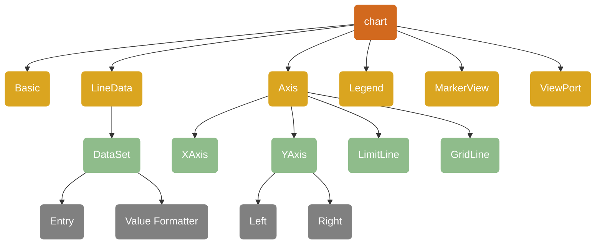
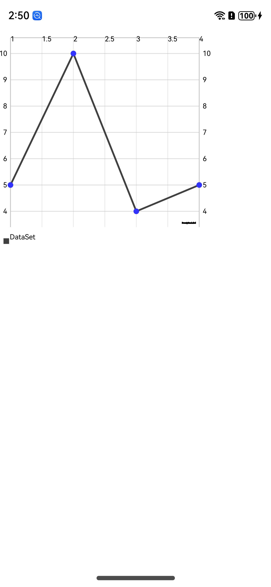

<div align="center">
<h1>chart4cj</h1>
</div>

<p align="center">


</p>

## 介绍

chart4cj 是一个包含各种类型图表的图表库，主要用于业务数据汇总，例如销售数据走势图，股价走势图等场景中使用，方便开发者快速实现图表 UI，chart4cj 主要包括线形图、柱状图、饼状图、蜡烛图、气泡图、雷达图、瀑布图等自定义图表库。

### 特性

- 支持饼状图
- 支持图例
- 支持柱状图（水平、垂直）
- 支持气泡图
- 支持瀑布图
- 支持线形图(暂不支持曲线及其填充)
- 支持蜡烛图
- 支持散点图
- 支持雷达图

### 软件架构


### 源码目录

```shell
├─AppScope
├─doc                         
├─entry                       
│  └─src
│      └─main
│          ├─cangjie      
│          └─resources
├─mpchart                       
│  └─src
│      └─main
│          ├─cangjie
│          │  └─src
│          │      ├─bar
│          │      ├─basedata
│          │      ├─bubble
│          │      ├─candle
│          │      ├─charts
│          │      ├─components
│          │      ├─line
│          │      ├─pie
│          │      ├─radar
│          │      ├─scatter
│          │      ├─utild
│          │      ├─waterfall
│          └─resources
└─hvigor
```
- AppScope 全局资源存放目录和应用全局信息配置目录
- doc API文档和使用手册存放目录
- entry 工程模块 - 编译生成一个HAP
- entry src main cangjie src 仓颉UI页面目录
- entry src main resources 资源文件目录
- mpchart 工程模块 - 编译生成一个har包
- mpchart src main cangjie src 仓颉各个图表源码目录
- mpchart src main resources 资源文件目录
- hvigor 构建工具目录

### 接口说明

主要类和函数接口说明详见 [API](doc/feature_api.md)

## 使用说明

### 编译构建

1. 通过 module 引入
    1. 克隆下载项目
    2. 将 mpchart 模块拷贝到应用项目下
    3. 修改自身应用 entry 下的 oh-package.json5 文件，在 dependencies 字段添加 "mpchart": "file:../mpchart"
      ```json
      {
         "name": "entry",
         "version": "1.0.0",
         "description": "Please describe the basic information.",
         "main": "",
         "author": "",
         "license": "",
        "dependencies": {
            "markdown": "file:../mpchart"
        }
      }
      ```
    4. 修改自身应用 entry/src/main/cangjie 下的 cjpm.toml 文件，在 [dependencies] 字段下添加 mpchart = {path = "../../../../mpchart/src/main/cangjie", version = "1.0.0"}
       ```toml
       [dependencies]
           mpchart = {path = "../../../../mpchart/src/main/cangjie", version = "1.0.0"}
       ```
    5. 在项目中使用 import mpchart.* 引用 mpchart 项目
       ```cangjie
       import mpchart.*
       ```
2. 把 chart4cj 作为三方库依赖引入
    1. 目标工程把 chart4cj 依赖库作为 git submodule 引入

    ```
    > cd $工程根目录
    > mkdir third-party
    > cd third-party
    > git submodule add "https://gitcode.com/Cangjie-TPC/chart4cj.git"
    ```
    2. 修改自身应用 entry/src/main/cangjie 下的 cjpm.toml 文件，添加依赖
    ```toml
    [dependencies]
        mpchart = {path = "../../../../third-party/chart4cj/mpchart/src/main/cangjie", version = "1.0.0"}
     ```
    3. 在项目中使用 chart 组件
       ```cangjie
       import mpchart.*
       ```

### 功能示例

#### 饼状图

```cangjie
import ohos.state_macro_manage.*
import ohos.base.LengthProp
import ohos.component.Column
import ohos.component.Row
import ohos.component.Button
import ohos.component.Text
import ohos.component.CustomView
import ohos.component.CJEntry
import ohos.component.loadNativeView
import ohos.state_manage.SubscriberManager
import ohos.state_manage.ObservedProperty
import ohos.state_macro_manage.Entry
import ohos.state_macro_manage.Component
import ohos.state_macro_manage.State
import ohos.state_macro_manage.r
import ohos.base.*
import ohos.component.*

import std.collection.{ArrayList}
import std.math.*
import std.random.*
import mpchart.pie.*
import mpchart.utils.*
import mpchart.components.*


@Entry
@Component
class PieChartPageReadme {
    //标题栏标题
    private var title: String = "PieChart"

    // 图表数据初始化
    // Step1:必须：初始化图表配置构建类
    private var model: PieChartModel = PieChartModel.build()
    protected let parties: Array<String> = ["Party A", "Party B", "Party C", "Party D", "Party E", "Party F", "Party G",
    "Party H", "Party I", "Party J", "Party K", "Party L", "Party M", "Party N", "Party O", "Party P", "Party Q",
    "Party R", "Party S", "Party T", "Party U", "Party V", "Party W", "Party X", "Party Y", "Party Z"]

    var pieData: PieData = PieData()

    func aboutToAppear(): PieChartModel {
        // Step2：配置图表的特定样式，各部件间没有先后之分
        let l: ?Legend = this.model.getLegend()
        if (let Some(v) <- l) {
            v.setEnabled(true)
            v.setOrientation(LegendOrientation.VERTICAL)
            v.setVerticalAlignment(LegendVerticalAlignment.BOTTOM)
            v.setHorizontalAlignment(LegendHorizontalAlignment.LEFT)
        }

        this.model.animateX(1000, easing: "Sharp"); // 启用X轴动画效果，动画持续时间为1000毫秒
        this.model.setUsePercentValues(true);  // 使用百分比值
        this.model.getDescription().setEnabled(false)  // 禁用描述信息
        this.model.setExtraOffsets(5.0, 10.0, 5.0, 5.0); // 设置额外偏移量
        
        this.model.setCenterText("mpchart"); // 设置中心文本
        this.model.setCenterTextSize(22.0) // 设置中心文本大小

        this.model.setDrawHoleEnabled(true); // 启用绘制中心孔
        this.model.setHoleColor(0xff000000);  // 设置中心孔颜色

        this.model.setTransparentCircleColor(0xff000000); // 设置透明圆环颜色
        this.model.setTransparentCircleAlpha(110.0); // 设置透明圆环透明度

        this.model.setHoleRadius(58.0); // 设置中心孔半径
        this.model.setTransparentCircleRadius(61.0);  // 设置透明圆环半径

        this.model.setDrawCenterText(true); // 绘制中心文本
        
        this.setData(4, 10);  // 设置图表数据
        return this.model
    }

    //初始化饼状图数据
    private func setData(count: Int64, range: Int64): Unit {
        var entries: ArrayList<PiEntry> = ArrayList<PiEntry>()
        for (i in 0..count) {
            entries.append(
                PiEntry((Random().nextFloat64() * Float64 (range)) + Float64 (range) / 5.0, this.parties[i % this.parties.size]))
        }

        // 创建饼状图数据集对象，设置数据项和数据集名称
        var dataSet: PieDataSet = PieDataSet(entries, "Election Results")
        // 设置是否绘制数据项图标
        dataSet.setDrawIcons(false)
        // 设置数据项之间的间隙
        dataSet.setSliceSpace(1.0)
        // 设置数据项图标的偏移量
        dataSet.setIconsOffset(MPPointF(0.0, 40.0))
        // 设置选中时数据项的偏移距离
        dataSet.setSelectionShift(5.0)
        // 设置数据项文本颜色
        dataSet.setValueTextColor(UInt32(0XFFFFFF))

        // 添加颜色
        var colors: ArrayList<UInt32> = ArrayList<UInt32>()
        for (i in 0..ColorTemplate.COLORFUL_COLORS.size) {
            colors.append(UInt32(ColorTemplate.COLORFUL_COLORS[i]))
        }

        for (i in 0..ColorTemplate.VORDIPLOM_COLORS.size) {
            colors.append(UInt32(ColorTemplate.VORDIPLOM_COLORS[i]))
        }

        for (i in 0..ColorTemplate.JOYFUL_COLORS.size) {
            colors.append(UInt32(ColorTemplate.JOYFUL_COLORS[i]))
        }

        for (i in 0..ColorTemplate.LIBERTY_COLORS.size) {
            colors.append(UInt32(ColorTemplate.LIBERTY_COLORS[i]))
        }
        for (i in 0..ColorTemplate.PASTEL_COLORS.size) {
            colors.append(UInt32(ColorTemplate.PASTEL_COLORS[i]))
        }
        colors.append(UInt32(ColorTemplate.getHoloBlue()))
        dataSet.setColorsByList(colors)

        // 生成图表数据
        let data: PieData = PieData(dataSet)
        // 将数据与图表配置类绑定
        this.model.setData(data)
    }

func build() {
        Column {
            PieChart(model: aboutToAppear())
        }.width(100.percent).height(70.percent).backgroundColor(Color.WHITE)
    }
}
```
<p align="left">

</p>

#### 柱状图

```cangjie
@Entry
@Component
class BarChartPageReadme {
    private var title: String = "Negative"
    private var model: BarChartModel = BarChartModel.build()
    private var leftAxis: ?YAxis = Option<YAxis>.None
    private var rightAxis: ?YAxis = Option<YAxis>.None
    private var xAxis: ?XAxis = Option<XAxis>.None
    private var barData: BarData = BarData()
    private var normalMarker: MarkerView = MarkerView()

    func aboutToAppear(): BarChartModel {
        let description: Description = this.model.getDescription()
        description.setEnabled(false)

        let l: ?Legend = this.model.getLegend()
        if (let Some(v) <- l) {
            v.setEnabled(true)
            v.setOrientation(LegendOrientation.VERTICAL)
            v.setVerticalAlignment(LegendVerticalAlignment.TOP)
            v.setHorizontalAlignment(LegendHorizontalAlignment.RIGHT)
            v.setDrawInside(true)
        }

        // if more than 40 entries are displayed in the this.model, no values will be drawn
        this.model.setMaxVisibleValueCount(60)
        
        this.model.setDrawGridBackground(false)
        this.model.setGridBackgroundColor(0x500000ff)
        this.model.setDrawBarShadow(false)

        this.model.setDrawValueAboveBar(true)

        this.leftAxis = this.model.getAxisLeft()
        if (let Some(leftaxis) <- this.leftAxis) {
            leftaxis.setAxisMinimum(0.0)
            leftaxis.setDrawLimitLinesBehindData(false)
            leftaxis.setSpaceTop(30.0)
            leftaxis.enableGridDashedLine(10, 10, 0)
        }

        this.rightAxis = this.model.getAxisRight()
        if (let Some(rightaxis) <- this.rightAxis) {
            rightaxis.setEnabled(false)
            rightaxis.setDrawGridLines(false)
            rightaxis.setLabelCount(6, false)
            rightaxis.setSpaceTop(11.0)
        }

        this.xAxis = this.model.getXAxis()
        if (let Some(xaxis) <- this.xAxis) {
            xaxis.setLabelCount(5, false)
            xaxis.setPosition(XAxisPosition.BOTTOM)
        }

        this.normalMarker = MarkerView()

        if (this.xAxis.isSome() && this.leftAxis.isSome()) {
            this.setData(5, 110)
        }

        return this.model
    }

    private func setData(count: Int64, range: Int64): Unit {
        let groupSpace: Float64 = 0.08
        let barSpace: Float64 = 0.03
        let barWidth: Float64 = 0.2

        let startYear: Int64 = 1980
        let endYear: Int64 = startYear + count

        let values1: ArrayList<BarEntry> = ArrayList<BarEntry>()
        let values2: ArrayList<BarEntry> = ArrayList<BarEntry>()
        let values3: ArrayList<BarEntry> = ArrayList<BarEntry>()
        let values4: ArrayList<BarEntry> = ArrayList<BarEntry>()

        let randomMultiplier: Int64 = range

        for (i in startYear..endYear) {
            values1.append(BarEntry(Float64(i), (Random().nextFloat64() * Float64(randomMultiplier))))
            values2.append(BarEntry(Float64(i), (Random().nextFloat64() * Float64(randomMultiplier))))
            values3.append(BarEntry(Float64(i), (Random().nextFloat64() * Float64(randomMultiplier))))
            values4.append(BarEntry(Float64(i), (Random().nextFloat64() * Float64(randomMultiplier))))
        }

        var set1: ?BarDataSet
        var set2: ?BarDataSet
        var set3: ?BarDataSet
        var set4: ?BarDataSet

        if (this.model.getBarData().isSome() && this.model.getBarData()().getDataSetCount() > 0) {
            set1 = this.model.getBarData()().getDataSetByIndex(0) as BarDataSet
            set2 = this.model.getBarData()().getDataSetByIndex(1) as BarDataSet
            set3 = this.model.getBarData()().getDataSetByIndex(2) as BarDataSet
            set4 = this.model.getBarData()().getDataSetByIndex(3) as BarDataSet
            set1().setEntries(values1)
            set2().setEntries(values2)
            set3().setEntries(values3)
            set4().setEntries(values4)
            this.model.getBarData()().notifyDataChanged()
            this.model.notifyDataSetChanged()
        } else {
            set1 = BarDataSet(values1, "Company A")
            set1().setColorsByArr([UInt32(ChartColor.rgb(104, 241, 175))])
            set2 = BarDataSet(values2, "Company B")
            set2().setColorsByArr([UInt32(ChartColor.rgb(164, 228, 251))])
            set3 = BarDataSet(values3, "Company C")
            set3().setColorsByArr([UInt32(ChartColor.rgb(242, 247, 158))])
            set4 = BarDataSet(values4, "Company D")
            set4().setColorsByArr([UInt32(ChartColor.rgb(255, 102, 0))])

            let dataSets: ArrayList<IBarDataSet> = ArrayList<IBarDataSet>()
            dataSets.append(set1())
            dataSets.append(set2())
            dataSets.append(set3())
            dataSets.append(set4())

            let data: BarData = BarData(dataSets)
            this.model.setData(data)
        }

        this.model.getBarData()().setBarWidth(barWidth)
        this.xAxis().setAxisMinimum(Float64(startYear))
        this.xAxis().setAxisMaximum(
            Float64(startYear) + this.model.getBarData()().getGroupWidth(groupSpace, barSpace) * Float64(count))
        this.model.groupBars(Float64(startYear), groupSpace, barSpace)
        this.model.invalidate()
    }

    func build() {
        Column {
            Text(this.title).fontSize(21).fontColor(Color.WHITE).fontWeight(FontWeight.W600).layoutWeight(1).maxLines(1)
            BarChart(model: aboutToAppear())
        }.width(100.percent).height(70.percent).backgroundColor(Color.WHITE)
    }
}

```
<p align="left">

</p>

#### 气泡图

```cangjie
@Entry
@Component
class BubbleChartPageReadme {
    private var menuItemArr: Array<String> = ["Animate X", "Animate Y", "Animate XY"]
    private var title: String = "BubbleChartPage"
    private var model: BubbleChartModel = BubbleChartModel.build()

    var isDrawValuesEnable: Bool = true
    var titleSelcetString: String = "X"

    public func animate() {
        if (this.titleSelcetString == "X") {
            this.model.animateX(2000)
        } else if (this.titleSelcetString == "Y") {
            this.model.animateY(2000)
        } else if (this.titleSelcetString == "XY") {
            this.model.animateXY(2000, 2000)
        }
    }

    func aboutToAppear(): BubbleChartModel {
        let l: ?Legend = this.model.getLegend()
        if (let Some(legend) <- l) {
            legend.setEnabled(true)
        }

        let description: Description = this.model.getDescription()
        description.setEnabled(false)

        this.model.setMaxVisibleValueCount(60)
        this.model.setDrawGridBackground(false)

        let xAxis: ?XAxis = this.model.getXAxis()
        if (let Some(x) <- xAxis) {
            x.setPosition(XAxisPosition.BOTTOM)
            x.setDrawGridLines(false)
            x.setGranularity(1.0)
            x.setLabelCount(7, false)
        }

        let leftAxis: ?YAxis = this.model.getAxisLeft()
        if (let Some(ly) <- leftAxis) {
            ly.setLabelCount(8, false)
            ly.setPosition(YAxisLabelPosition.OUTSIDE_CHART)
            ly.setSpaceTop(15.0)
            ly.setAxisMinimum(0.0)
        }

        let rightAxis: ?YAxis = this.model.getAxisRight()
        if (let Some(ry) <- rightAxis) {
            ry.setLabelCount(8, false)
            ry.setDrawGridLines(false)
            ry.setSpaceTop(15.0)
            ry.setAxisMinimum(0.0)
        }

        let start: Int64 = 1
        let values: ArrayList<BubblesEntry> = ArrayList<BubblesEntry>()
        for (i in start..20) {
            let val = (Random().nextFloat64() * 41.0)

            if (Random().nextFloat64() * 100.0 < 25.0) {
                values.append(BubblesEntry(Float64(i), val))
            } else {
                values.append(BubblesEntry(Float64(i), val))
            }
        }

        let dataSet: BubbleDataSet = BubbleDataSet(values, "DataSet")
        dataSet.setDrawIcons(false)

        let dataSetList: ArrayList<BubbleDataSet> = ArrayList<BubbleDataSet>()
        dataSetList.append(dataSet)

        this.setData(5, 50.0)
        this.model.notifyDataSetChanged()
        this.model.setVisibleXRangeMaximum(7.0)
        return this.model
    }

    private func setData(count: Int64, range: Float64): Unit {
        let values1 = ArrayList<BubblesEntry>()
        let values2 = ArrayList<BubblesEntry>()
        let values3 = ArrayList<BubblesEntry>()

        for (i in 0..count) {
            values1.append(BubblesEntry(Float64(i), Random().nextFloat64() * range, size: Random().nextFloat64() * range)
            )
            values2.append(BubblesEntry(Float64(i), Random().nextFloat64() * range, size: Random().nextFloat64() * range)
            )
            values3.append(BubblesEntry(Float64(i), Random().nextFloat64() * range, size: Random().nextFloat64() * range)
            )
        }

        let set1: BubbleDataSet = BubbleDataSet(values1, "DS 1")
        set1.setDrawIcons(false)
        set1.setColorByColor(0x88c12552)
        set1.setIconsOffset(MPPointF(0.0, 0.0))
        set1.setDrawValues(this.isDrawValuesEnable)

        let set2: BubbleDataSet = BubbleDataSet(values2, "DS 2")
        set2.setDrawIcons(false)
        set2.setIconsOffset(MPPointF(0.0, 0.0))
        set2.setColorByColor(0x88ff6600)
        set2.setDrawValues(this.isDrawValuesEnable)

        let set3: BubbleDataSet = BubbleDataSet(values3, "DS 3")
        set3.setDrawIcons(false)
        set3.setIconsOffset(MPPointF(0.0, 0.0))
        set3.setColorByColor(0x88f5c700)
        set3.setDrawValues(this.isDrawValuesEnable)

        let dataSets = ArrayList<IBubbleDataSet>()
        dataSets.append(set1)
        dataSets.append(set2)
        dataSets.append(set3)
        let dataResult: BubbleData = BubbleData(dataSets)
        dataResult.setDrawValues(this.isDrawValuesEnable)
        dataResult.setValueTextSize(8.0)
        dataResult.setValueTextColor(0xffffff)
        dataResult.notifyDataChanged()

        this.model.setData(dataResult)
    }

    func build() {
        Column() {
            Column() {
                BubbleChart(model: aboutToAppear())
            }
        }
    }
}

```
<p align="left">

</p>

#### 瀑布图

```cangjie
@Entry
@Component
class WaterfallChartPageReadme {
    private var model: WaterfallChartModel = WaterfallChartModel.build()
    private var dataSet: WaterfallDataSet = WaterfallDataSet(ArrayList<WaterfallEntry>(), "")
    private var leftAxis: ?YAxis = Option<YAxis>.None
    private var rightAxis: ?YAxis = Option<YAxis>.None
    private var xAxis: ?XAxis = Option<XAxis>.None
    private var limitLine1: LimitLine = LimitLine(100.0, "100")
    private var limitLine2: LimitLine = LimitLine(120.0, "Average")
    private var data: WaterfallData = WaterfallData()
    private var normalMarker: MarkerView = MarkerView()

    func aboutToAppear(): WaterfallChartModel {

        let description: ?Description = this.model.getDescription()
        if (let Some(des) <- description) {
            des.setEnabled(false);
        }

        let l: ?Legend = this.model.getLegend();
        if (let Some(legend) <- l) {
            legend.setEnabled(true);
        }
        
        this.model.setMaxVisibleValueCount(40);
        this.model.setDrawGridBackground(false);
        this.model.setGridBackgroundColor(0x500000ff)
        this.model.setDrawBarShadow(false);
        this.model.setDrawValueAboveBar(false);

        this.limitLine1 = LimitLine(120.0, "Upper Limit")
        this.limitLine1.setLineWidth(4.0);
        this.limitLine1.enableDashedLine(10, 10, 0);
        this.limitLine1.setLabelPosition(LimitLabelPosition.RIGHT_TOP);
        this.limitLine1.setTextSize(10.0);

        this.limitLine2 = LimitLine(50.0, "Lower Limit")
        this.limitLine2.setLineWidth(4.0);
        this.limitLine2.enableDashedLine(10, 10, 0);
        this.limitLine2.setLineColor(0xFFFF00);
        this.limitLine2.setLabelPosition(LimitLabelPosition.RIGHT_BOTTOM);
        this.limitLine2.setTextSize(10.0);
        
        this.leftAxis = this.model.getAxisLeft()
        if (let Some(laxis) <- this.leftAxis) {
            laxis.setAxisMinimum(0.0);
            laxis.setDrawLimitLinesBehindData(false);
            laxis.setValueFormatter(CustomFormatter());
            
            laxis.addLimitLine(this.limitLine1);
            laxis.addLimitLine(this.limitLine2);
        }

        this.rightAxis = this.model.getAxisRight()
        if (let Some(r) <- this.rightAxis) {
            r.setEnabled(false);
            r.setAxisMinimum(0.0);
        }

        this.xAxis = this.model.getXAxis()
        if (let Some(x) <- this.xAxis) {
            x.setPosition(XAxisPosition.BOTTOM);
        }

        this.normalMarker = MarkerView()
        this.data = this.getNormalData()
        this.model.setData(this.data);
        this.model.setVisibleXRangeMaximum(5.0);
        return this.model
    }

    private func getNormalData(): WaterfallData {
        let values: ArrayList<WaterfallEntry> = ArrayList<WaterfallEntry>();
        let h1 = WaterfallHighlight(20.0, 30.0, color: 0x999999);
        let h2 = WaterfallHighlight(30.0, 40.0, color: 0x999999);
        let h3 = WaterfallHighlight(40.0, 60.0, color: 0x339933);
        let h4 = WaterfallHighlight(60.0, 70.0, color: 0xFF0000);

        values.append(WaterfallEntry(1.0, 10.0, 30.0, highlights: [h1]));
        values.append(WaterfallEntry(2.0, 15.0, 50.0));
        values.append(WaterfallEntry(3.0, 20.0, 90.0));
        values.append(WaterfallEntry(4.0, 5.0, 95.0, highlights: [h2, h3, h4]));
        values.append(WaterfallEntry(5.0, 5.0, 50.0));
        values.append(WaterfallEntry(6.0, 45.0, 80.0, highlights: [h2, h3]));
        values.append(WaterfallEntry(7.0, 60.0, 70.0));

        this.dataSet = WaterfallDataSet(values, "DataSet")
        this.dataSet.setDrawIcons(false);
        this.dataSet.setColorByColor(0xFFC0CB);
        this.dataSet.setValueTextSize(10.0)

        let dataSetList: ArrayList<IWaterfallDataSet> = ArrayList<IWaterfallDataSet>();
        dataSetList.append(this.dataSet);

        let data: WaterfallData = WaterfallData(dataSetList);
        data.setBarWidth(0.3);
        return data;
    }

    func build() {
        Column() {
            Column() {
                WaterfallChart(model: aboutToAppear())
            }
            Row() {
                Row() {
                    Text("普通: ")
                    Radio(value: "CUBIC_BEZIER", group: "dataType").checked(true).onChange(
                        {
                        isChecked: Bool => if (isChecked) {
                            this.data = this.getNormalData()
                            this.model.setData(this.data);
                        }
                    })
                }
                
            }.alignSelf(ItemAlign.Center)
        }
    }
}

class CustomFormatter <: IAxisValueFormatter {
    public func getFormattedValue(value: Float64, axis: AxisBase): String {
        let str = value.format(".0").split(".")
        return "${str[0]}%";
    }
}
```
<p align="left">

</p>

#### 线形图

```cangjie
@Entry
@Component
class LineChartNotAxisConfigPageReadme {
    private var model: LineChartModel = LineChartModel.build()
    private var leftAxis: ?YAxis = Option<YAxis>.None
    private var rightAxis: ?YAxis = Option<YAxis>.None
    private var xAxis: ?XAxis = Option<XAxis>.None
    private var dataSet: LineDataSet = LineDataSet(ArrayList<EntryOhos>(), "Data Set")

    func aboutToAppear(): LineChartModel {
        let l: ?Legend = this.model.getLegend()
        if (let Some(v) <- l) {
            v.setEnabled(true)
            v.setOrientation(LegendOrientation.VERTICAL)
            v.setVerticalAlignment(LegendVerticalAlignment.BOTTOM)
            v.setHorizontalAlignment(LegendHorizontalAlignment.LEFT)
            v.setDrawInside(true)
            v.setYOffset(-10.0)
        }

        this.model.setMaxVisibleValueCount(60)
        let lineData: LineData = this.getLineData()
        lineData.setValueTextSize(10.0)
        this.model.setExtraOffsets(20.0,20.0,20.0,20.0)
        this.model.setData(lineData)

        this.model.invalidate()
        return this.model
    }

    private func getLineData(): LineData {
        let start: Int64 = 1
        let values: ArrayList<EntryOhos> = ArrayList<EntryOhos>()

        values.append( EntryOhos(1.0, 5.0));
        values.append( EntryOhos(2.0, 10.0));
        values.append( EntryOhos(3.0, 4.0));
        values.append( EntryOhos(4.0, 5.0));

        this.dataSet = LineDataSet(values, "DataSet")

        this.dataSet.setColorByColor(0x404040)
        this.dataSet.setMode(Mode.LINEAR)
        this.dataSet.setDrawCircles(true) //折线点画圆圈
        this.dataSet.setDrawCircleHole(false) //设置内部孔

        // 设置数据点的颜色
        this.dataSet.setCircleColor(0x3333FF)

        // 设置数据点的半径
        this.dataSet.setCircleRadius(4.0) // 设置半径大小
        this.dataSet.setCircleHoleRadius(2.0) //设置内径

        let dataSetList: ArrayList<ILineDataSet> = ArrayList<ILineDataSet>()
        dataSetList.append(this.dataSet)

        let lineData: LineData = LineData(dataSetList)
        return lineData
    }

    func build() {
        Column {
            LineChart(model: aboutToAppear())
        }.width(100.percent).height(70.percent).backgroundColor(Color.WHITE)
    }
}

```
<p align="left">

</p>

#### 蜡烛图

```cangjie
import ohos.base.*
import ohos.component.*
import ohos.state_manage.*
import ohos.state_macro_manage.*

@Entry
@Component
class CandlestickChartPage {
    private var model: CandleStickChartModel = CandleStickChartModel.build()

    func aboutToAppear(): CandleStickChartModel {
        let l: ?Legend = this.model.getLegend()
        if (let Some(legend) <- l) {
            legend.setEnabled(true)
        }

        let description: Description = this.model.getDescription()
        description.setEnabled(true)

        this.model.setMaxVisibleValueCount(60)
        this.model.setDrawGridBackground(true)
        this.model.setGridBackgroundColor(0xffffff)

        let xAxis: ?XAxis = this.model.getXAxis()
        if (let Some(x) <- xAxis) {
            x.setPosition(XAxisPosition.BOTTOM)
            x.setDrawGridLines(true)
        }

        let leftAxis: ?YAxis = this.model.getAxisLeft()
        if (let Some(ly) <- leftAxis) {
            ly.setLabelCount(7, false)
            ly.setDrawGridLines(true)
            ly.setDrawAxisLine(true)
        }

        let rightAxis: ?YAxis = this.model.getAxisRight()
        if (let Some(ry) <- rightAxis) {
            ry.setLabelCount(7, false)
            ry.setDrawGridLines(true)
            ry.setDrawAxisLine(true)
        }

        let start: Int64 = 1
        let values: ArrayList<BubblesEntry> = ArrayList<BubblesEntry>()

        for (i in start..20) {
            let val = (Random().nextFloat64() * 41.0)

            if (Random().nextFloat64() * 100.0 < 25.0) {
                values.append(BubblesEntry(Float64(i), val))
            } else {
                values.append(BubblesEntry(Float64(i), val))
            }
        }

        this.setData(40, 100.0)
        this.model.notifyDataSetChanged()
        return this.model
    }

    private func setData(count: Int64, range: Float64): Unit {
        let values = ArrayList<CandleEntry>()

        for (i in 0..count) {
            let val: Float64 = (Random().nextFloat64() * 40.0) + (range + 3.0)

            let high: Float64 = (Random().nextFloat64() * 9.0) + 8.0
            let low: Float64 = (Random().nextFloat64() * 9.0) + 8.0

            let open: Float64 = (Random().nextFloat64() * 6.0) + 1.0
            let close: Float64 = (Random().nextFloat64() * 6.0) + 1.0

            let even: Bool = i % 2 == 0

            values.append(
                CandleEntry(
                    Float64(i),
                    shadowH: val + high,
                    shadowL: val - low,
                    open: if (even) {
                        val + open
                    } else {
                        val - open
                    },
                    close: if (even) {
                        val - close
                    } else {
                        val + close
                    },
                )
            )
        }

        let dataSet: CandleDataSet = CandleDataSet(values, "candle data set")
        dataSet.setDrawIcons(false)
        dataSet.setAxisDependency(AxisDependency.LEFT)
        dataSet.setShadowColor(0x808080)
        dataSet.setShadowWidth(0.7)
        dataSet.setDecreasingPaintStyle(Style.FILL)
        dataSet.setDecreasingColor(0xff0000)
        dataSet.setIncreasingColor(0x008000)
        dataSet.setIncreasingPaintStyle(Style.STROKE)
        dataSet.setNeutralColor(0x0000ff)

        let data: CandleData = CandleData([dataSet])
        data.setValueTextSize(7.0)

        this.model.resetTracking()
        this.model.setData(data)
        this.model.invalidate()
    }

    func build() {
        Column() {
            Column() {
                CandleStickChart(model: aboutToAppear())
            }
        }
    }
}

```

<p align="left">

</p>

#### 散点图

```cangjie
import ohos.base.*
import ohos.component.*
import ohos.state_manage.*
import ohos.state_macro_manage.*

@Entry
@Component
class ScatterChartPage {
    private var model: ScatterChartModel = ScatterChartModel.build()

    func aboutToAppear(): ScatterChartModel {
        let l: ?Legend = this.model.getLegend()
        if (let Some(legend) <- l) {
            legend.setEnabled(true)
        }

        let description: Description = this.model.getDescription()
        description.setEnabled(true)

        this.model.setMaxVisibleValueCount(160);
        this.model.setDrawGridBackground(false);
        //  this.model.animateXY(2000, 2000)

        let xAxis: ?XAxis = this.model.getXAxis()
        if (let Some(xAxis) <- xAxis) {
            xAxis.setPosition(XAxisPosition.BOTTOM);
            xAxis.setDrawGridLines(false);
            xAxis.setGranularity(1.0);
            xAxis.setLabelCount(7, false);
        }

        let leftAxis: ?YAxis = this.model.getAxisLeft()
        if (let Some(leftAxis) <- leftAxis) {
            leftAxis.setLabelCount(8, false);
            leftAxis.setPosition(YAxisLabelPosition.OUTSIDE_CHART)
            leftAxis.setSpaceTop(15.0);
            leftAxis.setAxisMinimum(0.0);
        }

        let rightAxis: ?YAxis = this.model.getAxisRight()
        if (let Some(rightAxis) <- rightAxis) {
            rightAxis.setLabelCount(8, false);
            rightAxis.setDrawGridLines(false);
            rightAxis.setSpaceTop(15.0);
            rightAxis.setAxisMinimum(0.0);
        }

        let start: Int64 = 1
        let values: ArrayList<EntryOhos> = ArrayList<EntryOhos>()

        for (i in start..20) {
            let val = (Random().nextFloat64() * 41.0)

            if (Random().nextFloat64() * 100.0 < 25.0) {
                values.append(EntryOhos(Float64(i), val))
            } else {
                values.append(EntryOhos(Float64(i), val))
            }
        }

        this.setData(20.0, 100.0)
        this.model.notifyDataSetChanged()
        return this.model
    }

    private func setData(xRange: Float64, yRange: Float64): Unit {
        let values1 = this.generateRandomData(xRange, yRange);
        let values2 = this.generateRandomData(xRange, yRange);
        let values3 = this.generateRandomData(xRange, yRange);

        let set1 = ScatterDataSet(values1, "DS 1");
        set1.setScatterShape(ChartShape.SQUARE);
        set1.setColorByColor(0x008000);

        let set2 = ScatterDataSet(values2, "DS 2");
        set2.setScatterShape(ChartShape.CIRCLE);
        set2.setScatterShapeHoleColor(0xD2691E);
        set2.setScatterShapeHoleRadius(3.0);
        set2.setColorByColor(0x3333CC);

        let set3 = ScatterDataSet(values3, "DS 3");
        set3.setShapeRenderer(CustomScatterShapeRenderer());
        set3.setColorByColor(0xFFFF00);

        set1.setScatterShapeSize(8.0);
        set2.setScatterShapeSize(8.0);
        set3.setScatterShapeSize(8.0);

        let dataSets: ArrayList<IScatterDataSet> = ArrayList<IScatterDataSet>()
        dataSets.append(set1); // add the data sets
        dataSets.append(set2);
        dataSets.append(set3);

        let dataResult: ScatterData = ScatterData(dataSets);
        dataResult.setDrawValues(true);
        dataResult.setValueTextSize(8.0);
        dataResult.setHighlightEnabled(true);
        dataResult.setValueTextSize(10.0);

        this.model.setData(dataResult)
        dataResult.notifyDataChanged();
    }

    private func generateRandomData(xRange: Float64, yRange: Float64): ArrayList<EntryOhos> {
        let values = ArrayList<EntryOhos>();

        for (i in 0..Int64(xRange)) {
            let x = Float64(i); // Random x value within specified count.
            let y = Random().nextFloat64() * yRange; // Random y value within specified range.
            values.append(EntryOhos(x, y));
        }
        return values;
    }

    func build() {
        Column() {
            Column() {
                ScatterChart(model: aboutToAppear())
            }
        }
    }
}

public class CustomScatterShapeRenderer <: IShapeRenderer {
    public func renderShape(c: CanvasRenderingContext2D, dataSet: IScatterDataSet, viewPortHandler: ViewPortHandler,
        posX: Float64, posY: Float64, renderPaint: Paint): Unit {
        let shapeHalf: Float64 = dataSet.getScatterShapeSize() / 2.0;

        renderPaint.setStyle(Style.STROKE);
        renderPaint.setStrokeWidth(Utils.handleDataValues(1.0));
        Utils.resetContext2DStyle(c, renderPaint);
        c.beginPath();
        c.moveTo(posX - shapeHalf, posY - shapeHalf);
        c.lineTo(posX + shapeHalf, posY + shapeHalf);
        c.stroke();
        c.closePath();
    }
}
```

<p align="left">

</p>

#### 雷达图

```cangjie
import ohos.base.*
import ohos.component.*
import ohos.state_manage.*
import ohos.state_macro_manage.*

@Entry
@Component
class RadarChartPage {
    private var model: RadarChartModel = RadarChartModel.build()

    protected override func aboutToAppear() {
        let description: Description = this.model.getDescription()
        description.setEnabled(true);
        description.setText("this is radar")
        description.setPosition(100.0, 100.0)
        description.setTextColor(Color(0xffffff))
        description.setTextSize(15.0)

        let l: ?Legend = this.model.getLegend()
        if (let Some(legend) <- l) {
            legend.setEnabled(true);
            legend.setVerticalAlignment(LegendVerticalAlignment.TOP);
            legend.setHorizontalAlignment(LegendHorizontalAlignment.CENTER);
            legend.setOrientation(LegendOrientation.HORIZONTAL);
            legend.setDrawInside(false);
            legend.setXEntrySpace(7.0);
            legend.setYEntrySpace(5.0);
            legend.setTextColor(Color(0xffffff));
        }

        this.model.setWebLineWidth(0.3);
        this.model.setWebColor(0xFFCCCCCC);
        this.model.setWebLineWidthInner(0.3);
        this.model.setWebColorInner(0xFFCCCCCC);
        this.model.setExtraTopOffset(-100.0);
        this.model.animateXY(2000, 2000)

        let xAxis: ?XAxis = this.model.getXAxis()
        if (let Some(xAxis) <- xAxis) {
            xAxis.setPosition(XAxisPosition.BOTTOM);
            xAxis.setDrawGridLines(false);
            xAxis.setYOffset(0.0);
            xAxis.setXOffset(0.0);
            xAxis.setGranularity(1.0);
            xAxis.setLabelCount(7, false);
            xAxis.setValueFormatter(valueFormatter());
            xAxis.setTextColor(Color(0xffffff));
        }

        let leftAxis: ?YAxis = this.model.getYAxis()
        if (let Some(yAxis) <- leftAxis) {
            yAxis.setLabelCount(5, false);
            yAxis.setAxisMinimum(0.0);
            yAxis.setAxisMaximum(80.0);
            yAxis.setDrawLabels(false);
        }

        this.setData()
    }

    private func setData(): Unit {
        let mul = 80.0;
        let min = 20.0;
        let cnt = 5;

        let entries1: ArrayList<RadarEntry> = ArrayList<RadarEntry>();
        let entries2: ArrayList<RadarEntry> = ArrayList<RadarEntry>();

        for (i in 0..cnt) {
            let val1 = (Random().nextFloat64() * mul) + min;
            entries1.append(RadarEntry(val1));

            let val2 = (Random().nextFloat64() * mul) + min;
            entries2.append(RadarEntry(val2));
        }

        let set1: RadarDataSet = RadarDataSet(entries1, "Last Week");
        set1.setFillColor(UInt32(ChartColor.rgb(103, 110, 129)));
        set1.setDrawFilled(true);
        set1.setFillAlpha(180.0);
        set1.setLineWidth(2.0);
        set1.setDrawHighlightCircleEnabled(true);
        set1.setDrawHighlightIndicators(false);

        let set2: RadarDataSet = RadarDataSet(entries2, "This Week");
        set2.setFillColor(UInt32(ChartColor.rgb(121, 162, 175)));
        set2.setDrawFilled(true);
        set2.setFillAlpha(180.0);
        set2.setLineWidth(2.0);
        set2.setDrawHighlightCircleEnabled(true);
        set2.setDrawHighlightIndicators(false);

        let sets: ArrayList<IRadarDataSet> = ArrayList<IRadarDataSet>();
        sets.append(set1);
        sets.append(set2);

        let data: RadarData = RadarData(sets);
        data.setValueTextSize(20.0);
        data.setDrawValues(false);
        data.setValueTextColor(0xffffff);
        this.model.setData(data);
    }

    func build() {
        Column() {
            Column() {
                RadarChart(model: this.model)
            }
        }
    }
}

class valueFormatter <: IAxisValueFormatter {
    private var mActivities: Array<String> = ["Burger", "Steak", "Salad", "Pasta", "Pizza"];

    public func getFormattedValue(value: Float64, axis: AxisBase): String {
        return this.mActivities[Int64(floor(Float64(Int64(value) % (this.mActivities.size))))];
    }
}
```

<p align="left">

</p>

## 约束与限制

在下述版本验证通过：

    DevEco Studio NEXT Developer Beta2(5.0.3.600) 
    SDK: OHCangjie0.10.2-OH5.0.0.36

    1. 仓颉 UI 未支持手势组件，影响图表手势操作后的高亮、缩放、平移、旋转功能；
    2. 线形图曲线模式暂不支持；
    3. 饼状图、线形图填充效果暂不支持；
    4. 受仓颉 UI 画布组件 CanvasRenderingContext2D 的 measureText(String) 接口的影响，凡涉及到文本的地方都有距离误差；
    5. 散点图的的散布形状不支持实心圆，仅支持空心圆；
    6. 雷达图暂不支持填充功能；

## 开源协议

本项目基于 [Apache License 2.0](./LICENSE)，请自由的享受和参与开源。

## 参与贡献

欢迎给我们提交PR，欢迎给我们提交Issue，欢迎参与任何形式的贡献。
